---
# performance-check budget overrides, not part of the diagram itself.
# This file renders one flow twice - once as pseudo-code, once as a diagram - so
# its size is fixed by the skill's step count, and trimming to the bundled defaults
# would drop steps from the flow audit or drop a whole rendering.
# Parked in assets/ and never loaded by the model, so its words cost no context.
words-budget: 4096
lines-budget: 512
---

# address-pr-comments - flow overview

Human-facing overview for auditing the flow at a glance. Non-authoritative - the numbered steps in [`../SKILL.md`](../SKILL.md) win on any conflict. Regenerate this file whenever the skill's flow changes.

Two renderings of the same flow, kept cross-checkable on purpose. The `# N` comments in the pseudo-code are the diagram's node ids, so an id with no matching comment is drift.

The user is asked questions only up to step 5's debate close, which approves every commit, the push and every reply. After it, every fork is decided by a rule in the steps, so the run can finish while the user is away.

## Pseudo-code

Python-shaped for readability only; nothing here runs, and the function names stand for steps this skill performs, not real APIs.

```python
# 1 · Entry: /address-pr-comments PR# [filters]
def address_pr_comments(pr, filters):
    state = create(f"/tmp/address-pr-comments_{session_id}_{ts}.json")   # 2

    # 3 · Step 0 - read-only probing: is the tree dirty, which runners exist,
    #     is this checkout on the PR's branch, and does another worktree hold it?
    dirty = git("status", "--porcelain")
    runners = probe_lint_and_test_markers()
    pr_branch, cur_branch = gh_pr_head_ref(pr), git("branch", "--show-current")
    held_elsewhere = other_worktree_holds(pr_branch)   # from git worktree list

    # 4 · Step 0 - AskUserQuestion, asking only the conditions that hold;
    #     4 per call, so a 5th or 6th question goes in an immediate second call.
    answers = ask_in_batches_of_4(
        "Switch this checkout to the PR branch?"
            if cur_branch != pr_branch and not held_elsewhere else None,
        "Dirty tree - commit now?" if dirty else None,
        "Green baseline check?",              # default no - step 1c
        "Which runner?" if ambiguous(runners) else None,
        "Repo-green gate after changes?",     # default no - step 7 baseline + gate
        "Tails after this batch?",            # default no - step 9b
    )
    state.write(answers)   # 5 · persisted, so the answers survive compaction

    # ---- Step 1 · 1a-1d run sequentially, fail-fast on the first failure;
    #      the one recovery is the branch switch the user approved in step 0 ----
    # 6 · Step 1a - the persisted step-0 answers decide.
    if state.answers.branch == "stop_here":                # 6
        return abort("not on the PR branch - user chose to stop")    # 6a · before committing anything
    if state.answers.tree_is_dirty:
        if state.answers.dirty == "commit_now":            # 6b
            load_skill("commit-standards")                 # 6b1
            commit_dirty_files()                           # 6b2 · on the current branch, before any switch
        elif state.answers.dirty == "stop_here":           # 6c
            return abort("dirty tree - user chose to stop")              # 6c1
        # proceed_without_committing falls through

    if cur_branch != pr_branch:                            # 7 · Step 1b
        if state.answers.branch != "switch":               # 7a · another worktree holds it, or unanswered
            return abort("not on the PR branch - run gh pr checkout, "
                         "or work in the worktree holding it")           # 7a1
        gh("pr", "checkout", pr)                           # 7a2
        if checkout_failed() or git("branch", "--show-current") != pr_branch:  # 7a3
            # 7a3a · never stash or force: the stash stack is shared across worktrees.
            return abort("checkout failed - surface git's error")        # 7a3a
        run_repo_post_checkout_steps()                     # 7a4 · e.g. rebuild a library, regenerate a client

    if state.answers.baseline_check:                       # 8 · Step 1c
        lint_result, test_result = run_lint(), run_test()  # 8a
        if not both_green(lint_result, test_result):       # 8b
            load_skill("debug-standards")                  # 8b1
            return abort("fix the pre-existing breakage first")          # 8b2

    tails_on = state.answers.tails                         # 9 · Step 1d (not a pass/fail check)

    owner_repo, me = resolve_repo_and_login()              # 10 · Step 2

    # 11 · Step 3 - ONE subagent, general-purpose · sonnet · high, background.
    #      Fetch, filter, cluster, rank, propose. Self-AI gate: only unresolved,
    #      not-yet-answered items where ME left an AI!/AI?/AI: note. Per AI! it generalizes the
    #      note into a PR-wide Rule and sweeps every added line for Sites; per
    #      AI? it returns a Draft answer. Items dropped as already answered are
    #      listed (url + note preview), and step 5 lets the user pull one back.
    #      Returns only the proposal block.
    clusters = dispatch("general-purpose · sonnet · high", background=True)

    if not clusters:                                       # 12
        return stop("no candidate comments")               # 12a

    # 12b · same message as step 4, never waits on the window; once per run.
    launch_learn_run(f"/improve-from-user PR {owner_repo}#{pr}")   # 12b

    # 13 · Step 4 - TaskList BEFORE any chat or edit, so it survives compaction.
    #      One parent [Task] per cluster, one [Sub-Step] per marker with
    #      metadata.kind = command | question. Parent metadata holds
    #      comment_ids, thread_ids, urls. An answer-only cluster still gets a [Task].
    for c in clusters:
        parent = TaskCreate(f"[Task] {c.title}", metadata=c.ids_and_urls)
        for marker in c.markers:
            TaskCreate(f"[Sub-Step] {marker}", metadata={"kind": marker.kind})

    # 14 · Step 5 - ONE chat message: answer EVERY AI? from its Draft answer
    #      first, then challenge each AI! that looks wrong, over-reaching, or
    #      already handled (seeded by its Concern:). Each tied to path:line.
    #      It lists every apply cluster's Rule + Sites, contested or not, and
    #      ends by saying that closing the debate approves the commits, the
    #      push and the replies - the user's only look before those writes.
    send_qa_message(clusters)

    while True:                                            # debate in chat
        reply = read_user()
        if is_bare_ok(reply) and len(open_items()) > 1:    # 15a
            ask_which_items_it_closes()                    # 15a1
        elif reply.names_a_conclusion:                     # 15b
            # "change X" / "tell the reviewer Y" / "drop it" - no GitHub round-trip
            record_planned_command_or_reply(reply)         # 15b1 · persisted to the run-state file
            TaskCreate("[Sub-Step] <conclusion>", parent=c.task)  # 15b1 · its own sub-step
        if reply.says_question_is_clear:                   # 15c
            mark_sub_step_done(reply.question)             # 15c1
        # 15 · handle the reply first, then leave only when it changed no
        #      decision and nothing is open - even with nothing to debate,
        #      since that reply is the approval
        if not (open_questions() or open_challenges() or reply.names_a_conclusion):
            break

    # The debate's close approves every commit, the push and every reply:
    # bypassPermissions means none of them fires a permission prompt.

    # 16 · Step 6 - ONE Plan subagent, sonnet · medium, foreground, read-only.
    #      Follows references/plan-draft.md: reads the run-state file +
    #      reply-patterns.md and returns only the
    #      plan: per cluster intent (apply / answer / drop), for apply the
    #      Rule + Sites exactly as the file holds them, a one-line reply
    #      preview per reply. Every AI? cluster: a reply, or "no reply - <reason>".
    plan = dispatch("Plan · sonnet · medium", background=False, reads=state)

    # 17 · nobody else reviews the plan, so main checks it against the
    #      run-state file: same clusters, intents equal to the file's actions,
    #      apply Sites equal to the file's, every AI? cluster covered. Main
    #      fixes a mismatch from the file, or builds the plan from the file
    #      itself if the agent errored or returned no plan - never
    #      re-dispatches, never asks.
    plan = check_against(state, plan) if plan else build_plan_from(state)   # 17
    state.write(plan)          # 17 · steps 7, 9, 10 re-read it after a compaction
    post_chat_line(f"next: commits, push, replies per the plan in {state.path}")  # 17 · never waits

    # ---- Step 7 · from here on, no questions to the user ----
    if tails_on:                                           # 18 · Step 7 opening captures
        batch_base_sha = git("rev-parse", "HEAD")          # 18a
    if state.answers.repo_green_gate:                      # 18b
        # 18b1 · mode=baseline: fixes nothing, records evidence to diff against later.
        dispatch("repo-green-runner", mode="baseline", background=True)  # 18b1

    while apply_clusters_remaining():                      # 19 · in the plan's order
        c = next_apply_cluster()
        load_skill("code-standards", "test-standards", "doc-standards")  # 19a
        for site in c.sites:                               # 19b
            # 19b · located by CONTENT, not line number - earlier cluster
            #       commits shift lines. No match -> skip, list in Step 10.
            if not content_still_matches(site):
                sites_skipped.append(site)
                continue
            edit(site)                      # every site, not only commented lines
        git("add", only_files_in_scope_of(c))              # 19c
        load_skill("commit-standards")                     # 19d
        # 19e · subject `type(scope): cluster title`; body: blank line, then
        #       `Addresses:` (comment URLs) and `Sites:` (edited sites).
        sha = git("commit")                                # 19e
        # 19f · both surfaces updated: the [Task]'s metadata and the run-state file.
        TaskUpdate(c.task, metadata={"action": c.action, "commit_sha": sha,
                                     "status": "done"})
        state.write(c)
        mark_done(c.command_sub_steps)                     # 19f · after capturing the SHA

        if touched_files_outside(c.scope):                 # 19g
            # 19g1 · no one to ask, so the split is always made and
            #        reported in Step 10; a separate commit stays revertable.
            drift_sha = git("commit", files=outside_scope)  # 19g1 · [Drift] commit

    # 20 · repo-green GATE, opt-in, after all apply clusters, before the push.
    #      Fixes only batch-caused red; never touches pre-existing red.
    if state.answers.repo_green_gate:                      # 20
        dispatch("repo-green-runner", mode="gate", background=True)  # 20a
        verdict = read_gate_verdict()                      # 20b
        if verdict == "HALT":                              # 20b
            # 20b1 · never push broken commits; never hand-fix what the
            #        runner already handed back.
            return abort("repo-green gate HALT - surface surviving red")  # 20b1

    # 21 · Step 8 - single batch push, no confirmation: step 1b verified the
    #      branch and step 5's debate close covered the push.
    git("push")                                            # 21
    if push_rejected_remote_moved():                       # 22
        # 22a · the commits stand; never auto-rebase. The user resolves the
        #       divergence, then only the push is re-attempted, skipping step 7.
        return abort("remote moved")                       # 22a

    # ---- Step 9 · one reply per reply target, skipping "no reply" clusters ----
    # A target is one thread_id, one top-level comment, or one review-summary -
    # never a single comment inside a thread, which would post duplicates.
    while targets_remaining_in_planned_clusters():         # 23
        # 23a · per reply-patterns.md templates (apply / answer / drop; main
        #       loads it itself before the first reply, and reloads it if a
        #       compaction dropped it). Signature none only on text
        #       the user dictated verbatim. Loop, never batch.
        #       inline -> GraphQL addPullRequestReviewThreadReply(thread_id)
        #       top-level / review-summary -> REST issue comment
        #       cluster also holds an AI? -> append the answer summary after the commit URL
        result = post_reply(next_target())                 # 23a
        if result.gh_api_failed:                           # 23b
            retry = retry_gh_api_once()                    # 23b1
            if not retry.succeeded:                        # 23b2
                skip_and_list_in_final_report()            # 23b3 · target URL + unposted text
                continue                                   # 23b3 · cluster's [Task] stays open; loop never stops
        if cluster_done_or_no_reply(target):               # 23c
            mark_done(cluster.task, cluster.open_sub_steps)  # 23c · last reply posted, or plan said "no reply"

    if tails_on:                                           # 24 · Step 9b
        # 24a · tail pair per opt-in-gates.md: 2x code-reviewer, parallel,
        #       background, BASE_REF = batch_base_sha, no spec/plan.
        #       Report-only: the check-reviewer-writes.sh hook enforces it.
        dispatch_parallel("code-reviewer", base_ref=batch_base_sha)  # 24a

    # 25 · Step 10 - applied / sites skipped / answered / dropped / no reply
    #      (per plan) / drift commits / reply failures (target URL + unposted
    #      text) / open threads link,
    #      plus the repo-green verdict (when it ran) and tails report paths.
    return print(final_summary())
```

## Flowchart

```mermaid
flowchart TD
  n1(["1. /address-pr-comments PR# [filters]"]):::start
  n2["2. Create run-state file<br/>/tmp/address-pr-comments_&lt;session_id&gt;_&lt;ts&gt;.json"]:::state
  n3["3. Step 0: git status --porcelain;<br/>probe lint/test runner markers;<br/>compare PR head branch to current branch;<br/>git worktree list (all read-only)"]
  n4["4. Step 0: AskUserQuestion, 4 per call<br/>(only conditions that hold; a 5th/6th goes in a second call)<br/><br/>- Switch this checkout to the PR branch?<br/>(if not on it and no other worktree holds it)<br/>- Dirty tree -&gt; commit now? (if dirty)<br/>- Green baseline check? (default no)<br/>- Runner pick (if ambiguous/none)<br/>- Repo-green gate after changes? (default no)<br/>- Tails after this batch? (default no)"]:::gate
  n5["5. Persist step-0 answers to<br/>run-state file - survives compaction"]:::state
  n6{"6. Step 1a &middot; Branch answer stop_here,<br/>or working tree dirty?<br/>(1a-1d run sequentially, fail-fast on first failure;<br/>persisted step-0 answers decide)"}
  n6a["6a. Abort before committing anything:<br/>user chose not to switch branch"]
  n6b["6b. Dirty-tree answer commit_now"]
  n6b1["6b1. Load commit-standards<br/>(Skill tool)"]:::skill
  n6b2["6b2. Commit the dirty files<br/>on the current branch, before any switch"]
  n6c["6c. Dirty-tree answer stop_here"]
  n6c1["6c1. Abort: user chose to stop"]
  n7{"7. Step 1b &middot; On PR's branch?"}
  n7a{"7a. Branch answer switch?"}
  n7a1["7a1. Abort: not on PR branch<br/>run gh pr checkout, or work in<br/>the worktree that already holds it"]
  n7a2["7a2. gh pr checkout &lt;n&gt;<br/>then re-read the current branch"]
  n7a3{"7a3. Checkout succeeded<br/>and branch matches?"}
  n7a3a["7a3a. Abort with git's error<br/>never stash or force"]
  n7a4["7a4. Run the post-checkout steps the repo's CLAUDE.md names<br/>(rebuild a library, regenerate a client)"]
  n8{"8. Step 1c &middot; Baseline check<br/>opted in (step 0)?"}
  n8a["8a. Step 1c &middot; Run lint then test"]
  n8b{"8b. Step 1c &middot; Lint and test green?"}
  n8b1["8b1. Load debug-standards<br/>(Skill tool)"]:::skill
  n8b2["8b2. Abort: fix pre-existing<br/>breakage first"]
  n9["9. Step 1d: read persisted tails answer<br/>(not a pass/fail check; default no)"]:::state
  n10["10. Step 2: Resolve owner/repo<br/>and own gh login"]
  n11["11. Step 3: Dispatch subagent<br/>general-purpose &middot; sonnet &middot; high<br/>background<br/><br/>Fetch, filter, cluster, rank, propose<br/>Self-AI gate: unresolved, not yet answered by a later ME reply, where ME left an AI!/AI?/AI: note<br/><br/>AI! cluster: generalizes the note into a PR-wide Rule,<br/>sweeps every added line, returns Sites (before -&gt; after previews)<br/>AI? cluster: returns a Draft answer<br/>Lists items dropped as already answered (url + note preview)<br/>Returns only the proposal block"]:::dispatch
  n12{"12. Subagent found zero<br/>candidate comments?"}
  n12a["12a. Stop - no candidate comments"]
  n12b["12b. Step 3: launch lateral learn run<br/>/improve-from-user PR &lt;OWNER_REPO&gt;#&lt;n&gt;<br/>same message as step 4, never wait on the window"]:::dispatch
  n13["13. Step 4: Create the TaskList (before any chat or edit)<br/>one parent [Task] per cluster<br/>one [Sub-Step] per marker, metadata.kind = command | question<br/>parent metadata: comment_ids, thread_ids, urls<br/>(an answer-only cluster still gets a [Task])"]:::state
  n14["14. Step 5: ONE chat message<br/>answer EVERY AI? from its Draft answer first,<br/>then challenge each AI! that looks wrong, over-reaching,<br/>or already handled (seeded by its Concern:)<br/>each tied to path:line;<br/>lists every apply cluster's Rule + Sites;<br/>ends: closing the debate approves the commits, push, replies"]:::gate
  n15{"15. Reply handled: any question or<br/>challenge open, or did it change a decision?"}
  n15a{"15a. User replies: bare ok while<br/>several items are open?"}
  n15a1["15a1. Ask which open items it closes<br/>(never guess)"]:::gate
  n15b{"15b. User names a conclusion?<br/>(change X / tell reviewer Y / drop it)"}
  n15b1["15b1. Record as a planned command or reply,<br/>persisted to the run-state file<br/>(no GitHub round-trip)<br/>+ its own [Sub-Step] under the cluster's [Task]"]:::state
  n15c{"15c. User says a question<br/>is clear?"}
  n15c1["15c1. Mark that question's sub-step done"]:::state
  n16["16. Step 6: Dispatch Plan subagent<br/>Plan &middot; sonnet &middot; medium &middot; foreground, read-only<br/><br/>Follows references/plan-draft.md: reads the run-state file + reply-patterns.md<br/>returns only the plan: per cluster intent apply / answer / drop;<br/>apply: Rule + Sites exactly as the file holds them;<br/>one-line reply preview, or explicit no reply - reason"]:::dispatch
  n17["17. Main checks the plan against the run-state file<br/>(same clusters, intents, apply Sites; every AI? covered)<br/>fixes a mismatch from the file, or builds the plan itself if the agent errored or returned none;<br/>persists the plan, posts one chat line<br/>next: commits, push, replies per the plan - never waits"]:::state
  n18{"18. Step 7 &middot; Tails toggle on?"}
  n18a["18a. Capture BATCH_BASE_SHA = git rev-parse HEAD<br/>before the first commit"]:::state
  n18b{"18b. Repo-green gate<br/>toggle on (step 0)?"}
  n18b1["18b1. Dispatch repo-green-runner<br/>mode=baseline (background)<br/><br/>Fixes nothing; records log path,<br/>failure signatures, suite inventory<br/>for the gate below to diff against"]:::dispatch
  n19{"19. Step 7 &middot; More apply clusters<br/>to commit? (plan's order)"}
  n19a["19a. Load code-standards / test-standards /<br/>doc-standards as applicable<br/>(Skill tool)"]:::skill
  n19b["19b. Edit every site of the cluster (not only the commented lines),<br/>each located by content, not line number;<br/>a site whose content no longer matches is skipped<br/>and listed in the final report"]
  n19c["19c. Stage only files relevant to the cluster"]
  n19d["19d. Load commit-standards<br/>(Skill tool)"]:::skill
  n19e["19e. Commit: type(scope): cluster title<br/>body: blank line, then Addresses: (comment URLs)<br/>+ Sites: (edited sites)"]
  n19f["19f. Update cluster's [Task] metadata<br/>+ run-state file<br/>(action, commit_sha, status)<br/>then mark the cluster's command sub-steps done"]:::state
  n19g{"19g. Edits touched files<br/>outside cluster scope?"}
  n19g1["19g1. Always split them into a separate [Drift] commit<br/>(user is away, so no question)<br/>listed in the final report"]
  n20{"20. Repo-green gate<br/>toggle on (step 0)?"}
  n20a["20a. Dispatch repo-green-runner<br/>mode=gate (background)<br/><br/>Fixes only batch-caused red<br/>(own 3-cycle/signature budget);<br/>never touches pre-existing red"]:::dispatch
  n20b{"20b. Gate verdict?<br/>GREEN / GREEN-WITH-EXCEPTIONS / HALT"}
  n20b1["20b1. Abort: stop before push<br/>surface surviving red set<br/>never hand-fix, never auto-retry"]
  n21["21. Step 8: git push - single batch push<br/>no confirmation (step 5 debate close covered it)"]
  n22{"22. Push rejected<br/>remote moved?"}
  n22a["22a. Abort: surface to user<br/>commits stand, never auto-rebase<br/>user resolves; only the push is re-attempted"]
  n23{"23. Step 9 &middot; More reply targets in<br/>clusters with a planned reply?<br/>(target = one thread_id, top-level, or review-summary)"}
  n23a["23a. Post reply per reply-patterns.md templates<br/>(main loads it itself before the first reply)<br/>apply / answer / drop<br/>signature none only on user-dictated text<br/>inline &rarr; GraphQL addPullRequestReviewThreadReply<br/>top-level/review-summary &rarr; REST issue comment<br/>cluster also holds an AI? &rarr; append the answer summary after the commit URL"]:::gate
  n23b{"23b. gh api<br/>call failed?"}
  n23b1["23b1. Retry gh api once"]
  n23b2{"23b2. Retry<br/>succeeded?"}
  n23b3["23b3. Skip reply; cluster's [Task] stays open<br/>list target URL + unposted text in final report"]
  n23c["23c. Cluster's last reply posted, or plan said no reply:<br/>mark its parent [Task] and any open sub-steps done"]:::state
  n24{"24. Step 9b &middot; Tails toggle on<br/>(step 1d)?"}
  n24a["24a. Dispatch code-reviewer tail pair per opt-in-gates.md<br/>2x code-reviewer, parallel, background<br/>BASE_REF = BATCH_BASE_SHA, no spec/plan<br/>report-only (check-reviewer-writes.sh hook enforces it)"]:::dispatch
  n25["25. Step 10: Print final summary<br/>applied / sites skipped / answered / dropped /<br/>no reply (per plan) / drift commits /<br/>reply failures (target URL + unposted text) / open-threads link<br/>+ repo-green verdict (if it ran)<br/>+ tails report paths and top findings (if they ran)"]

  n1 --> n2
  n2 --> n3
  n3 --> n4
  n4 --> n5
  n5 --> n6
  n6 -->|"branch stop_here"| n6a
  n6 -->|"clean / proceed_without_committing"| n7
  n6 -->|"dirty"| n6b
  n6b --> n6b1
  n6b1 --> n6b2
  n6b2 --> n7
  n6 -->|"dirty"| n6c
  n6c --> n6c1
  n7 -->|"yes"| n8
  n7 -->|"no"| n7a
  n7a -->|"no - another worktree holds it, or unanswered"| n7a1
  n7a -->|"yes"| n7a2
  n7a2 --> n7a3
  n7a3 -->|"no"| n7a3a
  n7a3 -->|"yes"| n7a4
  n7a4 --> n8
  n8 -->|"no / unanswered"| n9
  n8 -->|"yes"| n8a
  n8a --> n8b
  n8b -->|"red"| n8b1
  n8b1 --> n8b2
  n8b -->|"green"| n9
  n9 --> n10
  n10 --> n11
  n11 --> n12
  n12 -->|"yes"| n12a
  n12 -->|"no"| n12b
  n12b --> n13
  n13 --> n14
  n14 --> n15a
  n15 -->|"yes - wait for the next reply"| n15a
  n15a -->|"yes"| n15a1
  n15a1 --> n15
  n15a -->|"no"| n15b
  n15b -->|"yes"| n15b1
  n15b1 --> n15c
  n15b -->|"no"| n15c
  n15c -->|"yes"| n15c1
  n15c1 --> n15
  n15c -->|"no"| n15
  n15 -->|"no - that reply closes the debate: approves every commit, the push, every reply"| n16
  n16 --> n17
  n17 --> n18
  n18 -->|"yes"| n18a
  n18a --> n18b
  n18 -->|"no"| n18b
  n18b -->|"yes"| n18b1
  n18b1 --> n19
  n18b -->|"no"| n19
  n19 -->|"yes"| n19a
  n19a --> n19b
  n19b --> n19c
  n19c --> n19d
  n19d --> n19e
  n19e --> n19f
  n19f --> n19g
  n19g -->|"yes"| n19g1
  n19g1 --> n19
  n19g -->|"no"| n19
  n19 -->|"no - all committed"| n20
  n20 -->|"yes"| n20a
  n20a --> n20b
  n20b -->|"GREEN / GREEN-WITH-EXCEPTIONS"| n21
  n20b -->|"HALT"| n20b1
  n20 -->|"no"| n21
  n21 --> n22
  n22 -->|"yes"| n22a
  n22 -->|"no"| n23
  n23 -->|"yes"| n23a
  n23a --> n23b
  n23b -->|"no"| n23c
  n23b -->|"yes"| n23b1
  n23b1 --> n23b2
  n23b2 -->|"yes"| n23c
  n23b2 -->|"no"| n23b3
  n23b3 --> n23
  n23c --> n23
  n23 -->|"no - all replied"| n24
  n24 -->|"yes"| n24a
  n24a --> n25
  n24 -->|"no"| n25

  classDef start fill:#fef3c7,stroke:#d97706,stroke-width:2px
  classDef gate fill:#fee2e2,stroke:#dc2626,stroke-width:2px
  classDef dispatch fill:#dbeafe,stroke:#2563eb,stroke-width:2px
  classDef state fill:#dcfce7,stroke:#16a34a,stroke-width:2px
  classDef skill fill:#f3e8ff,stroke:#9333ea,stroke-width:2px
```


