---
# performance-check budget override, not part of the diagram itself.
# This file renders one flow twice - once as pseudo-code, once as a diagram - so
# its size is fixed by the skill's step count, and trimming to the bundled default
# would drop steps from the flow audit or drop a whole rendering.
# Parked in assets/ and never loaded by the model, so its words cost no context.
words-budget: 2048
---

# code-review-guide - flow overview

Human-facing overview for auditing the flow at a glance. Non-authoritative - the numbered steps in [`../SKILL.md`](../SKILL.md) win on any conflict. Regenerate this file whenever the skill's flow changes.

Two renderings of the same flow, kept cross-checkable on purpose. The `# N` comments in the pseudo-code are the diagram's node ids, so an id with no matching comment is drift.

## Pseudo-code

Python-shaped for readability only; nothing here runs, and the function names stand for steps this skill performs, not real APIs.

```python
# 1 · Entry: /code-review-guide [<pr>] [--metrics <path>]
def code_review_guide(pr=None, metrics=None):
    # 2 · Seed one TaskList [Reminder] per step; scaffolding, never a go-ahead.
    TaskCreate("[Reminder] Step 1: resolve the snapshot")                 # 2a
    TaskCreate("[Reminder] Step 2: stack context")                        # 2b
    TaskCreate("[Reminder] Step 3: write the guide")                      # 2c
    TaskCreate("[Reminder] Step 4: deterministic checks")                 # 2d
    TaskCreate("[Reminder] Step 5: fresh-context verification")           # 2e
    TaskCreate("[Reminder] Step 6: post")                                 # 2f

    # 3 · Step 1 - gh pr view + gh repo view, fetch pull/N/head and the
    #     base, merge-base, diff.patch. Code is read only at the head SHA.
    #     Prints work_dir, clone, skill_dir, repo, number, sha, merge_base,
    #     base, head: later steps write those values as literals.
    snap = resolve_snapshot(pr or gh_pr_view_current_branch())

    # 4 · Is the snapshot trustworthy?
    if snap.failed or snap.pr_repo != snap.cwd_repo or not snap.head_found:
        return stop(snap.error)                                           # 4a

    # 5 · --metrics, else the newest verdict_metrics_* / verdict_quality-gate_*
    #     naming the head branch and newer than the head commit, else none.
    metrics = metrics or newest_fresh_verdict(snap) or None

    # 6 · Find the ticket: URL in the body, else a key in the title,
    #     else a key in the body, else a key in the branch name.
    ticket = find_ticket(snap)
    # 6a · Read it: Linear MCP get_issue, or the jira-cli skill. Reads only.
    ticket_text = read_ticket(ticket) if ticket else None
    #      Also its Linear project (name, URL, summary, description),
    #      or its Jira epic or parent, the same way.
    project_text = read_project(ticket) if ticket else None
    # 6b · Ticket, its project, then the PR part built from pr.json with jq,
    #      in priority order. A .txt file: verbatim source text, not a doc.
    write("goal-sources.txt", ticket_text, project_text, jq_pr_part(snap))

    # 7 · Step 2 - always walk down: child PRs whose base is this head branch.
    children = walk_down(snap, max_levels=10)
    # 8 · Is the base branch the default branch?
    parents = []
    if snap.base != snap.default_branch:
        # 8a · Walk up: open PR, else most recent, 10 levels max.
        parents = walk_up(snap, max_levels=10)

    # 9 · Any parent or child found?
    if parents or children:
        # 9a · Append each parent's ticket, project, body and title to
        #      goal-sources.txt, then write stack.md.
        stack = build_stack(snap, parents, children)
        write("stack.md", stack)
    else:
        stack = None                                                      # 9b

    # 10 · Step 3 - general-purpose, serial, wait for completion, opus high.
    #      Reads rules, template and example; given the clone, merge base,
    #      diff.patch and a scratch dir; writes guide.md with {EST1}/{EST2};
    #      returns the business-goal source it used, or "none", plus "uncertain"
    #      when the source only hints at the goal; never an invented goal.
    writer, goal_source = dispatch("general-purpose", model="opus", effort="high", inputs=(snap, stack, metrics))

    verified = False
    failed_rounds = 0  # one counter for the whole run, stamp and check alike
    while True:
        # 11 · Step 4 - stamp a copy, so guide.md keeps its placeholders.
        copy("guide.md", "guide.stamped.md")
        # 12 · Route on the stamp exit code; report it with the check's.
        stamp_rc = stamp_reading_time("guide.stamped.md").rc
        if stamp_rc == 1:
            failed_rounds += 1
            # 12b · 2 failed rounds reached? The run gets 1 retry.
            if failed_rounds >= 2:
                return stop("2 failed rounds", stamp_stderr)              # 14b1
            send(writer, stamp_stderr)                                    # 12a
            continue
        if stamp_rc != 0:
            return stop(read("stamp.txt"))                                # 12c
        # 13 · check-guide.py on the stamped copy.
        rc, lines = check_guide("guide.stamped.md")
        # 14 · Route on the check exit code.
        if rc == 1:
            failed_rounds += 1
            # 14b · 2 failed rounds reached? The run gets 1 retry.
            if failed_rounds >= 2:
                return stop("2 failed rounds", lines)                     # 14b1
            # 14b2 · mermaid-fixer first, agent-pinned, serial, wait for completion.
            dispatch("mermaid-fixer", "guide.md", mermaid_lines(lines))
            # 14b3 · then the writer, so one agent at a time edits guide.md.
            send(writer, other_lines(lines))
            continue
        if rc == 4:
            return stop("install mmdc: npm i -g @mermaid-js/mermaid-cli") # 14c
        if rc != 0:
            return stop(read("check.txt"))                                # 14d
        # 15 · Clean. Has the verifier already run?
        if verified:
            break
        # 16 · Step 5 - a separate general-purpose, serial, wait for completion, opus high.
        #      Given the clone, merge base, diff.patch and a scratch dir.
        #      Checks Camada 1, glossary, flags, edges, business goal at the SHA.
        mismatches = dispatch("general-purpose", model="opus", effort="high", guide="guide.stamped.md")
        verified = True
        # 17 · Any mismatch?
        if not mismatches:
            break
        send(writer, mismatches)                                          # 17a

    # 18 · Step 6 - jq -f payload.jq wraps in <details>, POST a new issue comment.
    response = gh_api_post_comment(wrap("guide.stamped.md"))
    # 19 · Re-fetch by id: does the stored body length match what was sent?
    if stored_length(response.id) != sent_length():
        report_both_lengths_never_repost(response.html_url)               # 19a
    else:
        print(response.html_url)                                          # 19b
    # 20 · Run report: URL, business-goal source or none, metrics or none,
    #      check rounds, verifier mismatch count.
    report()
```

## Flowchart

```mermaid
flowchart TD
  n1(["1. /code-review-guide [pr] [--metrics path]"]):::start

  subgraph n2["2. Seed one TaskList Reminder per step - scaffolding, never a go-ahead"]
    n2a["2a. [Reminder] Step 1: resolve the snapshot"]:::state
    n2b["2b. [Reminder] Step 2: stack context"]:::state
    n2c["2c. [Reminder] Step 3: write the guide"]:::state
    n2d["2d. [Reminder] Step 4: deterministic checks"]:::state
    n2e["2e. [Reminder] Step 5: fresh-context verification"]:::state
    n2f["2f. [Reminder] Step 6: post"]:::state
  end

  n3["3. Step 1 · gh pr view + gh repo view, fetch pull/N/head and the base,<br/>merge-base, diff.patch. Code is read only at the head SHA.<br/>Print work_dir, clone, skill_dir, repo, number, sha, merge_base - later steps use them as literals"]
  n4{"4. Snapshot resolved, PR in this repo,<br/>head commit found?"}
  n4a(["4a. Stop with the error - the guide would<br/>describe code other than the PR's"]):::gate
  n5["5. Metrics: --metrics, else the newest verdict naming the head branch<br/>and newer than the head commit, else none"]
  n6["6. Find the ticket: URL in the body, else a key in the title,<br/>else a key in the body, else a key in the branch name"]
  n6a["6a. Read it and its project (with summary), epic or parent:<br/>Linear MCP, or the jira-cli skill. Reads only"]:::skill
  n6b["6b. goal-sources.txt: ticket, its project, then the PR part from pr.json with jq, in priority order"]:::state

  n7["7. Step 2 · Walk down: child PRs whose base is this head branch, 10 levels max"]
  n8{"8. Base branch is the default branch?"}
  n8a["8a. Walk up: open PR, else most recent, 10 levels max"]
  n9{"9. Any parent or child PR found?"}
  n9a["9a. Append each parent's sources to goal-sources.txt.<br/>stack.md: ordered PR list, this PR marked"]:::state
  n9b["9b. Not stacked - no stack block"]

  n10[["10. Step 3 · Dispatch: Write review guide<br/>general-purpose · serial · wait for completion · opus high<br/>given the clone, merge base, diff.patch and a scratch dir<br/>reads rules, template, example - writes guide.md with EST1/EST2<br/>returns the business-goal source used, or none, and whether uncertain"]]:::dispatch

  n11["11. Step 4 · cp guide.md to guide.stamped.md, then stamp-reading-time.py.<br/>Report the stamp and check exit codes"]
  n12{"12. Stamp exit code?"}
  n12a["12a. SendMessage: stamp stderr to the writer"]
  n12b{"12b. Stamp exit 1 counts as a failed round.<br/>2 failed rounds reached? 1 retry"}
  n12c(["12c. Stop: show stamp.txt"]):::gate
  n13["13. check-guide.py on guide.stamped.md"]
  n14{"14. check-guide exit code?"}
  n14b{"14b. Exit 1 counts as a failed round.<br/>2 failed rounds reached? One counter for the whole run"}
  n14b1(["14b1. Stop, never post: report the last errors and guide.md"]):::gate
  n14b2[["14b2. Dispatch first: Fix guide mermaid<br/>mermaid-fixer · agent-pinned · serial · wait for completion<br/>the mermaid violation lines"]]:::dispatch
  n14b3["14b3. Then SendMessage: every other violation line, verbatim, to the writer"]
  n14c(["14c. Stop: mmdc missing - npm i -g @mermaid-js/mermaid-cli"]):::gate
  n14d(["14d. Stop: show check.txt"]):::gate

  n15{"15. Verifier already ran?"}
  n16[["16. Step 5 · Dispatch: Verify review guide<br/>general-purpose · serial · wait for completion · opus high<br/>given the clone, merge base, diff.patch and a scratch dir<br/>Camada 1, glossary, flags, edges, business goal at the head SHA"]]:::dispatch
  n17{"17. Any mismatch?"}
  n17a["17a. SendMessage: mismatches with path:line evidence to the writer"]

  n18["18. Step 6 · jq -f payload.jq wraps in details, gerado por IA footer, POST a new issue comment"]
  n19{"19. Re-fetched body length equals the sent length?"}
  n19a(["19a. Report both lengths and the URL - never re-post"]):::gate
  n19b["19b. Print the comment URL"]
  n20(["20. Run report: URL, business-goal source (ticket, project, PR) or none,<br/>whether uncertain, metrics or none, check rounds, mismatch count"]):::state

  n1 --> n2 --> n3 --> n4
  n4 -->|"no"| n4a
  n4 -->|"yes"| n5 --> n6 --> n6a --> n6b --> n7 --> n8
  n8 -->|"no"| n8a --> n9
  n8 -->|"yes"| n9
  n9 -->|"yes"| n9a --> n10
  n9 -->|"no"| n9b --> n10
  n10 --> n11 --> n12
  n12 -->|"0"| n13
  n12 -->|"1"| n12b
  n12b -->|"yes"| n14b1
  n12b -->|"no"| n12a --> n11
  n12 -->|"other"| n12c
  n13 --> n14
  n14 -->|"0"| n15
  n14 -->|"1"| n14b
  n14b -->|"yes"| n14b1
  n14b -->|"no"| n14b2 --> n14b3 --> n11
  n14 -->|"4"| n14c
  n14 -->|"other"| n14d
  n15 -->|"no"| n16 --> n17
  n15 -->|"yes"| n18
  n17 -->|"yes"| n17a --> n11
  n17 -->|"no"| n18
  n18 --> n19
  n19 -->|"no"| n19a --> n20
  n19 -->|"yes"| n19b --> n20

  classDef start fill:#fef3c7,stroke:#d97706,stroke-width:2px
  classDef gate fill:#fee2e2,stroke:#dc2626,stroke-width:2px
  classDef dispatch fill:#dbeafe,stroke:#2563eb,stroke-width:2px
  classDef state fill:#dcfce7,stroke:#16a34a,stroke-width:2px
  classDef skill fill:#f3e8ff,stroke:#9333ea,stroke-width:2px
  classDef hook fill:#e5e7eb,stroke:#4b5563,stroke-width:2px
```


