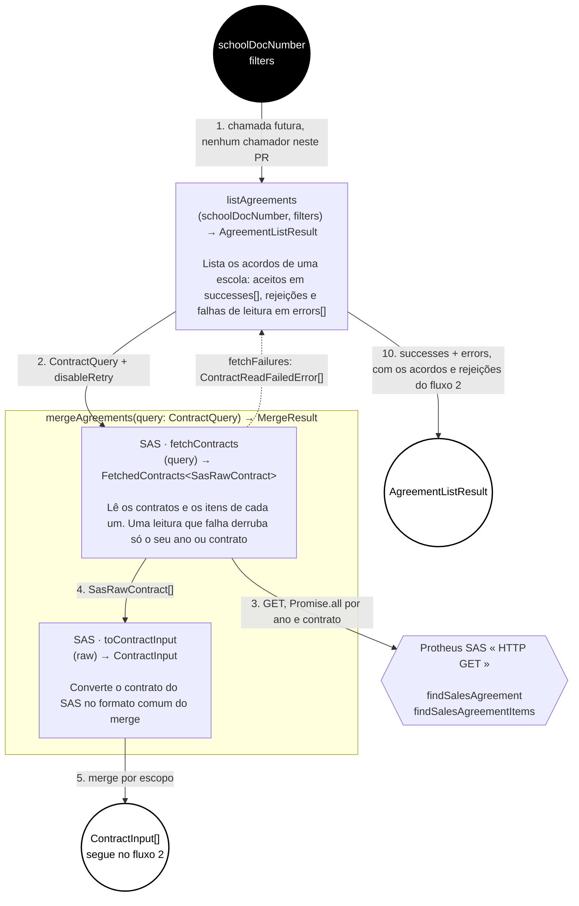
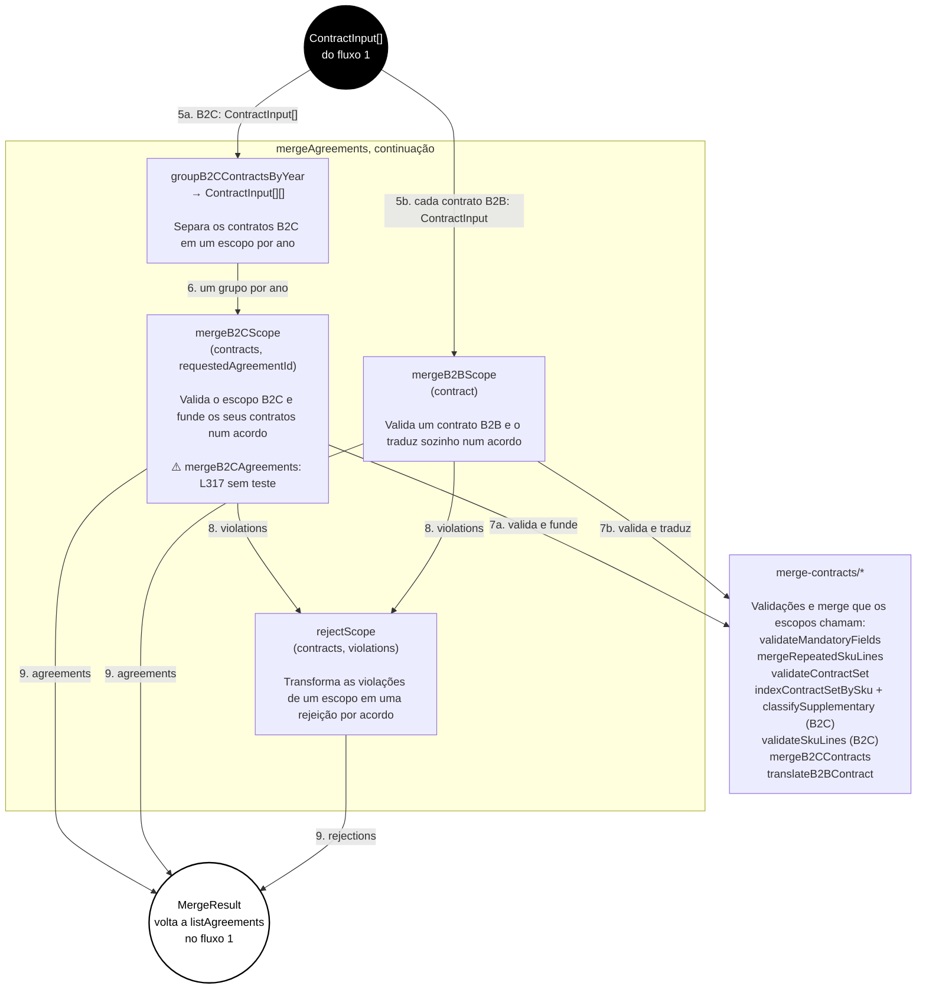
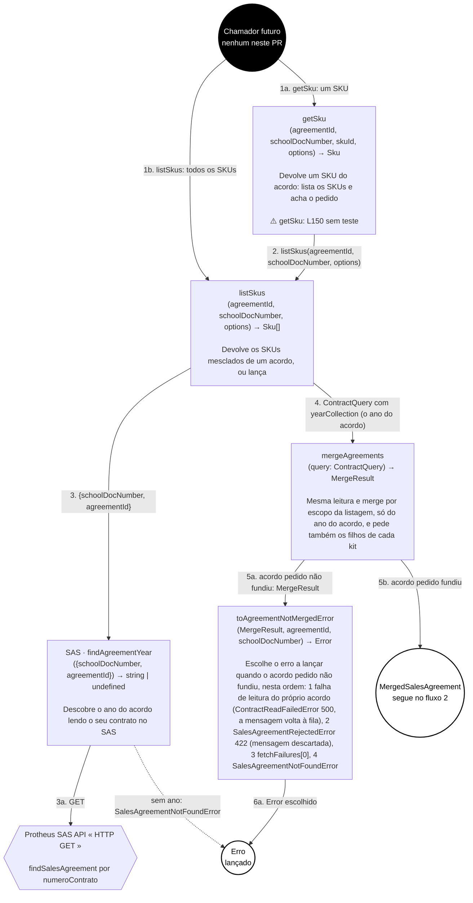
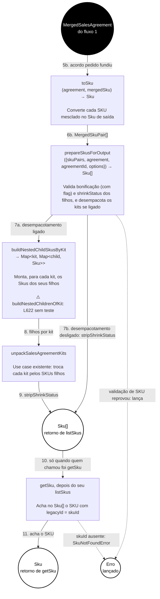

---
# performance-check budget override, not part of the guide itself.
# This file reproduces the real, user-approved review guide for PR 2720,
# so trimming it would make the worked example unrealistic rather than
# smaller. Both budgets are raised from the bundled defaults (1024 words,
# 256 lines) to the next power of two that fits.
words-budget: 8192
lines-budget: 512
---
# Guia de review: PR #2720

Snapshot gerado sobre o commit [`2e38a6a`](https://github.com/arco-cv/arco2-integrator/pull/2720/commits/2e38a6a).

## ⏱ Camada 1 · o essencial (~4 min)

**Objetivo de negócio.** O BKO passa a ler só o contrato SALES do integrador, então esse contrato precisa trazer todos os SKUs de SAS, SAE e IS que o BKO usa: aluno pagante, aluno cortesia e professor/coordenador. Hoje ele chega com SKUs faltando ([fonte](https://linear.app/isaac/project/contratos-b2c-sas-sae-e-is-e-skus-como-sales-p-remessa-antecipada-de-a0f23e9497eb)).

**Entregável.** Use cases que leem contratos do Protheus SAS e devolvem acordos de venda e SKUs já mesclados e validados por escopo, ainda sem nenhum chamador.

**Risco de mudança: Baixo.**

- Nenhum código de produção chama os use cases novos: `sales-agreements.module.ts` só os registra ([:95](https://github.com/arco-cv/arco2-integrator/blob/2e38a6a/core/src/modules/sales-agreements/sales-agreements.module.ts#L95)) e exporta ([:203](https://github.com/arco-cv/arco2-integrator/blob/2e38a6a/core/src/modules/sales-agreements/sales-agreements.module.ts#L203)).

- Duas funções existentes mudam: `buildMergedSku` copia 3 campos novos para cada SKU mesclado, e `translateB2BContract` devolve `warnings` como `SoldStaffSkuWarning[]`.

- Só o use case novo chega nessas duas funções ([B:328](https://github.com/arco-cv/arco2-integrator/blob/2e38a6a/core/src/modules/sales-agreements/shared/use-cases/base-protheus-merged-agreement.use-case.ts#L328), [B:398](https://github.com/arco-cv/arco2-integrator/blob/2e38a6a/core/src/modules/sales-agreements/shared/use-cases/base-protheus-merged-agreement.use-case.ts#L398)).

- O resto dos arquivos existentes faz mudanças menores:

  - Acrescenta códigos de erro e o campo opcional `isSupplementary` ([data-quality.error.ts:11](https://github.com/arco-cv/arco2-integrator/blob/2e38a6a/core/src/modules/sales-agreements/get-sales-agreements-by-contrated-brands/errors/data-quality.error.ts#L11), [types.ts:47](https://github.com/arco-cv/arco2-integrator/blob/2e38a6a/lib/src/protheus-client/src/sas/types.ts#L47)).

  - Move campos de tipo e extrai `hasFourDigitYear` de uma checagem que já existia ([validate-contract-set.ts:27](https://github.com/arco-cv/arco2-integrator/blob/2e38a6a/core/src/modules/sales-agreements/shared/merge-contracts/validate-contract-set.ts#L27)).

  - Exporta nomes novos nos índices ([index.ts:9](https://github.com/arco-cv/arco2-integrator/blob/2e38a6a/core/src/modules/sales-agreements/shared/merge-contracts/index.ts#L9)).

  - Remove o tipo `SalesAgreements` e o export de `InvalidItemDisciplineError`, ambos sem uso restante no código.

**O que muda.** Novo use case que lê acordos de venda do Protheus SAS e devolve acordos e SKUs já mesclados por *escopo*. Os termos em itálico estão definidos no Glossário logo abaixo.

- Uma classe base genérica guarda a regra de merge, validação e SKU; a classe SAS só busca e mapeia.

- 2 arquivos novos concentram o código de produção: base +672 e SAS +441 linhas, com 107 testes em 2 specs novos (+1394, +1154).

- Os outros 15 arquivos de produção somam +194/-44, incluindo o novo `contract-read-failed.error.ts` (+90). Outros 3 specs somam +53/-7.

- Entrada / Saída: só 2 GETs HTTP ao Protheus SAS. Nenhum banco, fila, tópico ou cache.

**Glossário.** As abstrações do código que o resto do guia usa, na ordem em que o fluxo passa por elas.

- *Hook* ([B:124-143](https://github.com/arco-cv/arco2-integrator/blob/2e38a6a/core/src/modules/sales-agreements/shared/use-cases/base-protheus-merged-agreement.use-case.ts#L124-L143)): um dos 4 métodos abstratos da classe base que a classe SAS preenche: `fetchContracts`, `findAgreementYear`, `toContractInput` e `isProductUnpackingEnabled`.

- *Falha de leitura* (`ContractReadFailedError`, [contract-read-failed.error.ts:33](https://github.com/arco-cv/arco2-integrator/blob/2e38a6a/core/src/modules/sales-agreements/shared/errors/contract-read-failed.error.ts#L33)): um GET ao Protheus que falhou. Derruba só o seu ano (B2C) ou o seu contrato.

  - A listagem a devolve em `errors[]`. Os caminhos de SKU a lançam com 500, e a mensagem volta à fila.

- *Contrato* (`ContractInput`, [types.ts:95](https://github.com/arco-cv/arco2-integrator/blob/2e38a6a/core/src/modules/sales-agreements/shared/merge-contracts/types.ts#L95)): um contrato do Protheus já mapeado pela classe SAS, com id (`legacyId`), tipo, modelo de negócio, ano e linhas de SKU.

- *Tipo de contrato* ([shared/types.ts:31](https://github.com/arco-cv/arco2-integrator/blob/2e38a6a/core/src/modules/sales-agreements/shared/types.ts#L31)): Venda (`SALES`), Remessa (`SHIPMENT`) ou Bonificado (`BONUS`). O acordo leva o id e o cabeçalho do contrato de Venda.

- *Escopo* ([B:262-283](https://github.com/arco-cv/arco2-integrator/blob/2e38a6a/core/src/modules/sales-agreements/shared/use-cases/base-protheus-merged-agreement.use-case.ts#L262-L283)): a unidade que é mesclada ou rejeitada junta.

  - B2C: os contratos de uma escola e um ano formam um escopo, que vira um acordo.

  - Todo contrato que não é B2B conta como B2C, inclusive com modelo de negócio vazio.

  - B2B: cada contrato B2B é um escopo sozinho, e um B2B que não é de Venda é rejeitado.

  - Um ano malformado junta todos os contratos B2C da escola num só escopo, rejeitado inteiro. Só os ids que as violações nomeiam vão para `errors[]` ([B:413-424](https://github.com/arco-cv/arco2-integrator/blob/2e38a6a/core/src/modules/sales-agreements/shared/use-cases/base-protheus-merged-agreement.use-case.ts#L413-L424), [B:431](https://github.com/arco-cv/arco2-integrator/blob/2e38a6a/core/src/modules/sales-agreements/shared/use-cases/base-protheus-merged-agreement.use-case.ts#L431)).

- *Conjunto B2C* (`B2CContractSet`, [validate-contract-set.ts:23](https://github.com/arco-cv/arco2-integrator/blob/2e38a6a/core/src/modules/sales-agreements/shared/merge-contracts/validate-contract-set.ts#L23)): a Venda de um escopo B2C, com a sua Remessa e, se houver, o seu Bonificado.

  - São rejeitados: Venda sem Remessa, Remessa ou Bonificado sem Venda, e 2 contratos do mesmo tipo no mesmo ano ([validate-contract-set.ts:165](https://github.com/arco-cv/arco2-integrator/blob/2e38a6a/core/src/modules/sales-agreements/shared/merge-contracts/validate-contract-set.ts#L165), [:118](https://github.com/arco-cv/arco2-integrator/blob/2e38a6a/core/src/modules/sales-agreements/shared/merge-contracts/validate-contract-set.ts#L118), [:135](https://github.com/arco-cv/arco2-integrator/blob/2e38a6a/core/src/modules/sales-agreements/shared/merge-contracts/validate-contract-set.ts#L135)).

- *Suplementar* (`isSupplementary`, [classify-supplementary.ts:9](https://github.com/arco-cv/arco2-integrator/blob/2e38a6a/core/src/modules/sales-agreements/shared/merge-contracts/classify-supplementary.ts#L9)): marca uma linha de SKU como suplementar ou padrão.

  - Com `FEAT_FLAG_SALES_AGREEMENT_SUPPLEMENTARY_VALIDATION_ENABLED` ligada, vale o que o Protheus mandou, e `false` quando ele não manda nada.

  - Desligada, só o SKU de aluno bonificado recebe a marca: suplementar se veio da Venda, padrão se veio do Bonificado. As outras linhas perdem o valor.

- *Violação* (`AgreementViolation`, [types.ts:108](https://github.com/arco-cv/arco2-integrator/blob/2e38a6a/core/src/modules/sales-agreements/shared/merge-contracts/types.ts#L108)): uma regra quebrada, com código e mensagem. Um escopo com qualquer violação é rejeitado inteiro.

- *Rejeição* (`AgreementRejection`, [sales-agreement-rejected.error.ts:8](https://github.com/arco-cv/arco2-integrator/blob/2e38a6a/core/src/modules/sales-agreements/shared/errors/sales-agreement-rejected.error.ts#L8)): o que a listagem devolve em `errors[]`, com as suas violações.

  - Sai uma por id que as violações nomeiam. A violação sem id vai para a Venda do escopo, ou para o primeiro contrato se não há Venda ([B:426-449](https://github.com/arco-cv/arco2-integrator/blob/2e38a6a/core/src/modules/sales-agreements/shared/use-cases/base-protheus-merged-agreement.use-case.ts#L426-L449)).

- *Acordo mesclado* (`MergedSalesAgreement`, [types.ts:149](https://github.com/arco-cv/arco2-integrator/blob/2e38a6a/core/src/modules/sales-agreements/shared/merge-contracts/types.ts#L149)): o resultado de um escopo aceito.

  - B2C: `mergeB2CContracts` junta o conjunto num acordo.

  - B2B: `translateB2BContract` traduz a Venda sozinha, sem merge.

- *SKU mesclado* (`MergedSku`, [types.ts:128](https://github.com/arco-cv/arco2-integrator/blob/2e38a6a/core/src/modules/sales-agreements/shared/merge-contracts/types.ts#L128)): um código de SKU do acordo, juntando as linhas dos contratos do conjunto. Guarda as quantidades vendida e bonificada separadas.

- *Kit*: um SKU composto por outros SKUs, os filhos.

  - Desempacotar ([B:381](https://github.com/arco-cv/arco2-integrator/blob/2e38a6a/core/src/modules/sales-agreements/shared/use-cases/base-protheus-merged-agreement.use-case.ts#L381)) troca cada kit pelos seus filhos na saída de SKUs.

  - Liga com `FEAT_FLAG_SALES_AGREEMENT_PRODUCT_UNPACKING_SAS_ENABLED` ou com `forceProductUnpacking` no pedido ([S:136-138](https://github.com/arco-cv/arco2-integrator/blob/2e38a6a/core/src/modules/sales-agreements/shared/use-cases/protheus-sas-merged-agreement.use-case.ts#L136-L138)).

**Entrypoints.** Não há ponto de entrada único: nenhum controller, consumer ou handler chama esses use cases ainda. Só o registro em `sales-agreements.module.ts` ([:95](https://github.com/arco-cv/arco2-integrator/blob/2e38a6a/core/src/modules/sales-agreements/sales-agreements.module.ts#L95)).

- Comece em `BaseProtheusMergedAgreementUseCase` ([B:111](https://github.com/arco-cv/arco2-integrator/blob/2e38a6a/core/src/modules/sales-agreements/shared/use-cases/base-protheus-merged-agreement.use-case.ts#L111)), nos 3 métodos públicos: `listAgreements`, `listSkus` e `getSku`.

- Depois veja os 4 hooks que `ProtheusSasMergedAgreementUseCase` ([S:48](https://github.com/arco-cv/arco2-integrator/blob/2e38a6a/core/src/modules/sales-agreements/shared/use-cases/protheus-sas-merged-agreement.use-case.ts#L48)) preenche.

## ⏱ Camada 2 · fluxos: comportamento pelos testes, depois o diagrama (~27 min)

Feature flags lidas:

- `FEAT_FLAG_SALES_AGREEMENT_PRODUCT_UNPACKING_SAS_ENABLED` ([S:137](https://github.com/arco-cv/arco2-integrator/blob/2e38a6a/core/src/modules/sales-agreements/shared/use-cases/protheus-sas-merged-agreement.use-case.ts#L137))
  - Ligada, ou com `forceProductUnpacking`: valida o shrinkStatus dos filhos e troca cada kit pelos seus SKUs filhos.

  - Desligada: os SKUs saem como estão, só sem o shrinkStatus.

- `FEAT_FLAG_SAS_SALES_AGREEMENT_KIT_CHILD_DETAILS_ENABLED` ([S:276](https://github.com/arco-cv/arco2-integrator/blob/2e38a6a/core/src/modules/sales-agreements/shared/use-cases/protheus-sas-merged-agreement.use-case.ts#L276))
  - Só age nos caminhos de SKU (`listSkus` e `getSku`). A listagem de acordos não pede filhos de kit ([S:265](https://github.com/arco-cv/arco2-integrator/blob/2e38a6a/core/src/modules/sales-agreements/shared/use-cases/protheus-sas-merged-agreement.use-case.ts#L265), [B:198](https://github.com/arco-cv/arco2-integrator/blob/2e38a6a/core/src/modules/sales-agreements/shared/use-cases/base-protheus-merged-agreement.use-case.ts#L198)).

  - Ligada, ou com o desempacotamento ligado: pede ao Protheus os filhos de cada kit com detalhes, incluindo o shrinkStatus.

  - Desligada: pede só os códigos dos filhos.

- `FEAT_FLAG_SALES_AGREEMENT_SUPPLEMENTARY_VALIDATION_ENABLED` ([B:384](https://github.com/arco-cv/arco2-integrator/blob/2e38a6a/core/src/modules/sales-agreements/shared/use-cases/base-protheus-merged-agreement.use-case.ts#L384))
  - Ligada: `isSupplementary` vem do Protheus, e o merge B2C reprova um SKU de aluno bonificado no contrato errado.

  - Desligada: o contrato em que o SKU de aluno bonificado está diz se ele é suplementar. Só reprova o SKU bonificado nos dois contratos.

- `FEAT_FLAG_SKU_BONIFICATION_VALIDATION_ENABLED` ([B:367](https://github.com/arco-cv/arco2-integrator/blob/2e38a6a/core/src/modules/sales-agreements/shared/use-cases/base-protheus-merged-agreement.use-case.ts#L367))
  - Ligada: os caminhos de SKU lançam `BonificationValidationErrors` para kit bonificado com filho não bonificado, ou `storePrice` 0 sem bonificação ([validate-sku-bonification.use-case.ts:42-56](https://github.com/arco-cv/arco2-integrator/blob/2e38a6a/core/src/modules/sales-agreements/shared/use-cases/validate-sku-bonification.use-case.ts#L42-L56)).

  - A checagem de bonificação parcial nunca reprova aqui: `toSku` monta `bonused` sempre em valor absoluto ([base-protheus-merged-agreement.use-case.ts:561](https://github.com/arco-cv/arco2-integrator/blob/2e38a6a/core/src/modules/sales-agreements/shared/use-cases/base-protheus-merged-agreement.use-case.ts#L561), [validate-sku-bonification.use-case.ts:18-21](https://github.com/arco-cv/arco2-integrator/blob/2e38a6a/core/src/modules/sales-agreements/shared/use-cases/validate-sku-bonification.use-case.ts#L18-L21)).

  - Desligada: nenhuma dessas checagens roda.

Cada fluxo abaixo traz primeiro os seus testes, depois o seu diagrama. Cada teste aparece uma vez, no primeiro fluxo que o executa; um fluxo que reusa o mesmo código aponta para lá.

Um ⚠️ numa caixa de diagrama marca uma métrica no limite ou acima dele, ou linhas que nenhum dos 803 testes unitários de `shared/` executa. Os testes e2e não rodaram.

### Listagem: CNPJ → contratos SAS → merge por escopo → successes[] + errors[]

A listagem **nunca lança** por problema de um acordo: violações e falhas de leitura viram `errors[]`. Exceção: falha na primeira `findSalesAgreement` ([S:73](https://github.com/arco-cv/arco2-integrator/blob/2e38a6a/core/src/modules/sales-agreements/shared/use-cases/protheus-sas-merged-agreement.use-case.ts#L73)) propaga.

#### Fluxo 1: leitura no SAS

**Testes deste fluxo (50).**

✅ Happy (11)

- Lê a Venda e todos os contratos relacionados do mesmo CNPJ e ano, com qualquer modelo de negócio. Escola só com Vendas B2B não lê Remessa nem Bonificado.

- Faz uma só leitura por ano, sem filtrar o tipo de contrato, qualquer que seja o número de Vendas B2C.

- O mapeamento leva os campos obrigatórios, `isSupplementary` só com a flag ligada, e o preço de venda como storePrice menos o desconto.

- A listagem não pede os filhos de kit ao Protheus. O mapeamento guarda o shrinkStatus de cada filho que vier.

📄 [`protheus-sas-merged-agreement.use-case.spec.ts`](https://github.com/arco-cv/arco2-integrator/blob/2e38a6a/core/test/modules/sales-agreements/shared/use-cases/protheus-sas-merged-agreement.use-case.spec.ts) › mapping into ContractInput

- `should map the brand's supplementary field and every mandatory field into ContractInput while the flag is on`

- `should omit isSupplementary from every SKU while the flag is off, even when Protheus sent a value`

- `should serve the Protheus store price as the catalog price and subtract the discount from it for the selling price`

- `should carry the Protheus item description as title and description of a standalone and a non-unpacked kit SKU`

📄 [`protheus-sas-merged-agreement.use-case.spec.ts`](https://github.com/arco-cv/arco2-integrator/blob/2e38a6a/core/test/modules/sales-agreements/shared/use-cases/protheus-sas-merged-agreement.use-case.spec.ts) › kit children

- `should send no kit-child param on the agreement listing`

- `should keep the shrink status Protheus sends on each kit child so the unpacking can run`

📄 [`protheus-sas-merged-agreement.use-case.spec.ts`](https://github.com/arco-cv/arco2-integrator/blob/2e38a6a/core/test/modules/sales-agreements/shared/use-cases/protheus-sas-merged-agreement.use-case.spec.ts) › fetching the contracts

- `should fetch the Venda contract and every related contract of the same CNPJ and year, whatever its business model, and the related contracts of a year with no B2C Venda contract`

- `should read no Remessa contract or Bonificado contract for a school whose Venda contracts are all B2B`

- `should list the contracts of the year with one read of no contract type, whatever the number of B2C Venda contracts`

📄 [`base-protheus-merged-agreement.use-case.spec.ts`](https://github.com/arco-cv/arco2-integrator/blob/2e38a6a/core/test/modules/sales-agreements/shared/use-cases/base-protheus-merged-agreement.use-case.spec.ts) › rejections › contract read failures

- `should word the failure message by the read that failed, for the read OWN_ITEMS`

- `should word the failure message by the read that failed, for the read RELATED_CONTRACT`

🔶 Corner (3)

- Desconto negativo do Protheus vira o seu valor absoluto.

- Volume em branco vira SKU sem volume, não um número inválido.

- Na listagem, a leitura dos contratos relacionados roda sem retry.

📄 [`protheus-sas-merged-agreement.use-case.spec.ts`](https://github.com/arco-cv/arco2-integrator/blob/2e38a6a/core/test/modules/sales-agreements/shared/use-cases/protheus-sas-merged-agreement.use-case.spec.ts) › mapping into ContractInput

- `should serve the magnitude of a negative Protheus discount, never a negative discount`

- `should serve a SKU as without volume when Protheus sends its volume blank, not as a non-number`

📄 [`protheus-sas-merged-agreement.use-case.spec.ts`](https://github.com/arco-cv/arco2-integrator/blob/2e38a6a/core/test/modules/sales-agreements/shared/use-cases/protheus-sas-merged-agreement.use-case.spec.ts) › related read failures

- `should disable retries on the related read of the listing`

❌ Failure (34)

- Contrato sem tipo, ano ou lista de linhas, ou linha sem preço, quantidade ou código de SKU: o mapeamento rejeita o acordo.

- Uma leitura que falha vira um código no id da Venda: timeout vira `ERP_TIMEOUT_ERROR`, erro de servidor `ERP_SERVER_INTERNAL_ERROR`, e o resto o código da leitura que falhou.

- A falha derruba só o seu ano (B2C) ou o seu contrato (B2B). Os outros anos e contratos seguem servidos.

- Remessa B2B, ou Remessa sem Venda no ano, é rejeitada sozinha e o acordo B2C segue. Bonificado com modelo de negócio em branco rejeita o acordo do ano.

📄 [`protheus-sas-merged-agreement.use-case.spec.ts`](https://github.com/arco-cv/arco2-integrator/blob/2e38a6a/core/test/modules/sales-agreements/shared/use-cases/protheus-sas-merged-agreement.use-case.spec.ts) › mapping into ContractInput

- `should reject the agreement when Protheus sends a line without its price`

- `should reject the agreement when Protheus sends a line without its quantity`

- `should reject the agreement when Protheus sends a line without its SKU code`

- `should reject a B2C contract whose contract type is "" instead of treating it as a Venda contract`

- `should reject a B2C contract whose contract type is null instead of treating it as a Venda contract`

- `should reject a B2C contract whose contract type is "doacao" instead of treating it as a Venda contract`

- … e mais 1 caso do mesmo `it.each` (4 no total), [no spec](https://github.com/arco-cv/arco2-integrator/blob/2e38a6a/core/test/modules/sales-agreements/shared/use-cases/protheus-sas-merged-agreement.use-case.spec.ts#L217)

- `should reject a contract whose year Protheus sent as "" without reporting a year Protheus never sent`

- `should reject a contract whose year Protheus sent as "   " without reporting a year Protheus never sent`

- `should reject a contract whose year Protheus sent as undefined without reporting a year Protheus never sent`

- `should reject the agreement when Protheus sends a contract without its lines list`

📄 [`protheus-sas-merged-agreement.use-case.spec.ts`](https://github.com/arco-cv/arco2-integrator/blob/2e38a6a/core/test/modules/sales-agreements/shared/use-cases/protheus-sas-merged-agreement.use-case.spec.ts) › related read failures

- `should report a related read failing with 502 as ERP_TIMEOUT_ERROR under the Venda contract id`

- `should report a related read failing with 503 as ERP_SERVER_INTERNAL_ERROR under the Venda contract id`

- `should report a related read failing with 404 as AGREEMENT_B2C_RELATED_CONTRACT_FETCH_FAILED under the Venda contract id`

- … e mais 3 casos do mesmo `it.each` (6 no total), [no spec](https://github.com/arco-cv/arco2-integrator/blob/2e38a6a/core/test/modules/sales-agreements/shared/use-cases/protheus-sas-merged-agreement.use-case.spec.ts#L603)

📄 [`protheus-sas-merged-agreement.use-case.spec.ts`](https://github.com/arco-cv/arco2-integrator/blob/2e38a6a/core/test/modules/sales-agreements/shared/use-cases/protheus-sas-merged-agreement.use-case.spec.ts) › related items read failures isolated per year

- `should serve the healthy year and the B2B Venda contract and report only the failing year under its Venda contract`

- `should report every failing year, each under its own Venda contract`

- `should report one entry per Venda contract of a failing year`

📄 [`protheus-sas-merged-agreement.use-case.spec.ts`](https://github.com/arco-cv/arco2-integrator/blob/2e38a6a/core/test/modules/sales-agreements/shared/use-cases/protheus-sas-merged-agreement.use-case.spec.ts) › own items read failures

- `should report the items failure of a B2C Venda contract under its id, with no timeout or 5xx, and still serve another year and the B2B Venda contract`

- `should report an items read that times out as an ERP timeout under the B2C Venda contract id`

- `should report the items failure of one B2B Venda contract only, and still serve another B2B Venda contract and the B2C year`

📄 [`protheus-sas-merged-agreement.use-case.spec.ts`](https://github.com/arco-cv/arco2-integrator/blob/2e38a6a/core/test/modules/sales-agreements/shared/use-cases/protheus-sas-merged-agreement.use-case.spec.ts) › related contracts outside the B2C Venda contract year and business model

- `should reject the agreement of a year whose Bonificado contract has a blank business model instead of serving it without the bonused units`

- `should reject a B2B Remessa contract listed in the year of a B2C Venda contract, and still serve that B2C agreement`

- `should reject a B2B Remessa contract of a year with no Venda contract, and still serve the B2C agreement`

- `should reject a B2C Remessa contract of a year with no Venda contract as an orphan, and still serve the B2C agreement`

- `should report the items read failure of an orphan Remessa contract under its own id, and still serve the B2C agreement`

📄 [`base-protheus-merged-agreement.use-case.spec.ts`](https://github.com/arco-cv/arco2-integrator/blob/2e38a6a/core/test/modules/sales-agreements/shared/use-cases/base-protheus-merged-agreement.use-case.spec.ts) › rejections › contract read failures

- `should not retry and report the ERP error code on the Venda contract id when a related contract read fails with TIMEOUT, giving ERP_TIMEOUT_ERROR`

- `should not retry and report the ERP error code on the Venda contract id when a related contract read fails with SERVER_ERROR, giving ERP_SERVER_INTERNAL_ERROR`

- `should report the related-contract failure code on the Venda contract id for any other fetch failure`

- `should report the items failure code on the Venda contract id when its own items read fails with neither a timeout nor a 5xx`

- `should keep the ERP code for an own items read that fails with TIMEOUT, giving ERP_TIMEOUT_ERROR`

- `should keep the ERP code for an own items read that fails with SERVER_ERROR, giving ERP_SERVER_INTERNAL_ERROR`

📝 Logs (2)

- Uma falha de leitura gera um aviso com a leitura, o tipo da falha e a causa do Protheus, e entra na linha info da listagem, que leva o CNPJ.

📄 [`base-protheus-merged-agreement.use-case.spec.ts`](https://github.com/arco-cv/arco2-integrator/blob/2e38a6a/core/test/modules/sales-agreements/shared/use-cases/base-protheus-merged-agreement.use-case.spec.ts) › logging

- `should log one info line carrying the cnpj when the listing reports a related-contract fetch failure`

- `should warn with the failed read, the failure kind and the Protheus cause when a contract read fails, and list it on the served line`

#### Fluxo 2: merge por escopo

**Testes deste fluxo (103).**

✅ Happy (75)

- Um acordo B2C válido é aceito com a flag de suplementar ligada ou desligada, com ou sem Bonificado, e linhas repetidas em qualquer contrato (60 casos).

- Uma Venda B2B é aceita com SKU de aluno ou professor, vendido, vendido e bonificado ou 100% bonificado, com ou sem linhas repetidas.

- Uma escola B2C com contratos de dois anos gera um acordo por ano.

- A listagem calcula as séries pelos kits e SKUs avulsos, sem desempacotar.

📄 [`base-protheus-merged-agreement.use-case.spec.ts`](https://github.com/arco-cv/arco2-integrator/blob/2e38a6a/core/test/modules/sales-agreements/shared/use-cases/base-protheus-merged-agreement.use-case.spec.ts) › happy cases

- `should list the merged agreement under successes when every check passes`

- `should accept a B2C agreement with FEAT_FLAG_SALES_AGREEMENT_SUPPLEMENTARY_VALIDATION_ENABLED on, the Bonificado contract present, a supplementary student SKU placed where that flag allows, a TEACHER Remessa contract SKU and repeated lines in the Venda contract`

- `should accept a B2C agreement with FEAT_FLAG_SALES_AGREEMENT_SUPPLEMENTARY_VALIDATION_ENABLED on, the Bonificado contract absent, a regular student SKU placed where that flag allows, a COORDINATOR Remessa contract SKU and repeated lines in the Remessa contract`

- `should accept a B2C agreement with FEAT_FLAG_SALES_AGREEMENT_SUPPLEMENTARY_VALIDATION_ENABLED off, the Bonificado contract present, a supplementary student SKU placed where that flag allows, a OTHER Remessa contract SKU and repeated lines in the Bonificado contract`

- … e mais 57 casos do mesmo `it.each` (60 no total), [no spec](https://github.com/arco-cv/arco2-integrator/blob/2e38a6a/core/test/modules/sales-agreements/shared/use-cases/base-protheus-merged-agreement.use-case.spec.ts#L290)

- `should accept a B2B Venda contract holding a STUDENT SKU, sold only, with repeated lines absent`

- `should accept a B2B Venda contract holding a TEACHER SKU, sold and bonified, with repeated lines present`

- `should accept a B2B Venda contract holding a TEACHER SKU, 100% bonified, with repeated lines absent`

- … e mais 9 casos do mesmo `it.each` (12 no total), [no spec](https://github.com/arco-cv/arco2-integrator/blob/2e38a6a/core/test/modules/sales-agreements/shared/use-cases/base-protheus-merged-agreement.use-case.spec.ts#L356)

📄 [`base-protheus-merged-agreement.use-case.spec.ts`](https://github.com/arco-cv/arco2-integrator/blob/2e38a6a/core/test/modules/sales-agreements/shared/use-cases/base-protheus-merged-agreement.use-case.spec.ts) › kits

- `should derive grades on the agreement listing from kit-level and standalone SKUs, without unpacking kits`

📄 [`base-protheus-merged-agreement.use-case.spec.ts`](https://github.com/arco-cv/arco2-integrator/blob/2e38a6a/core/test/modules/sales-agreements/shared/use-cases/base-protheus-merged-agreement.use-case.spec.ts) › B2C contracts of several years

- `should list one merged agreement per year when a B2C school has contracts for two years`

🔶 Corner (6)

- Um escopo rejeitado não derruba os outros: o B2B limpo e o ano válido seguem em `successes`.

- Duas Vendas B2C no mesmo ano geram uma entrada em `errors` por Venda.

- Com a flag de bonificação ligada, um SKU vendido a preço zero ainda é listado: essa checagem só roda nos caminhos de SKU.

- Um SKU B2B com público que não é aluno só gera um aviso, e o acordo é listado.

📄 [`base-protheus-merged-agreement.use-case.spec.ts`](https://github.com/arco-cv/arco2-integrator/blob/2e38a6a/core/test/modules/sales-agreements/shared/use-cases/base-protheus-merged-agreement.use-case.spec.ts) › logging

- `should log one warning per B2B Venda contract SKU whose target user is not a student, and still list the agreement`

📄 [`base-protheus-merged-agreement.use-case.spec.ts`](https://github.com/arco-cv/arco2-integrator/blob/2e38a6a/core/test/modules/sales-agreements/shared/use-cases/base-protheus-merged-agreement.use-case.spec.ts) › FEAT_FLAG_SALES_AGREEMENT_SUPPLEMENTARY_VALIDATION_ENABLED

- `should list a student SKU bonused in the Venda contract but sent as not supplementary while the flag is off`

📄 [`base-protheus-merged-agreement.use-case.spec.ts`](https://github.com/arco-cv/arco2-integrator/blob/2e38a6a/core/test/modules/sales-agreements/shared/use-cases/base-protheus-merged-agreement.use-case.spec.ts) › FEAT_FLAG_SKU_BONIFICATION_VALIDATION_ENABLED

- `should still list a sold SKU priced at zero while the flag is on, when listAgreements is called`

📄 [`base-protheus-merged-agreement.use-case.spec.ts`](https://github.com/arco-cv/arco2-integrator/blob/2e38a6a/core/test/modules/sales-agreements/shared/use-cases/base-protheus-merged-agreement.use-case.spec.ts) › rejections › merge violations

- `should list a clean B2B agreement under successes while a rejected B2C agreement of the same school goes under errors with the B2C Venda contract id`

📄 [`base-protheus-merged-agreement.use-case.spec.ts`](https://github.com/arco-cv/arco2-integrator/blob/2e38a6a/core/test/modules/sales-agreements/shared/use-cases/base-protheus-merged-agreement.use-case.spec.ts) › rejections › SKU query by the id of a non-Venda contract › two B2C Venda contracts of the same year

- `should list one errors entry per Venda contract`

📄 [`base-protheus-merged-agreement.use-case.spec.ts`](https://github.com/arco-cv/arco2-integrator/blob/2e38a6a/core/test/modules/sales-agreements/shared/use-cases/base-protheus-merged-agreement.use-case.spec.ts) › B2C contracts of several years

- `should list the valid year's agreement while another year's B2C set is rejected`

❌ Failure (18)

- Um campo obrigatório ausente ou um `targetUser` inválido rejeita só com esse código, sem rodar as checagens seguintes.

- As demais violações saem todas juntas numa rejeição: linhas repetidas em conflito, conjunto B2C e linhas de SKU.

- Com `dataQualityErrors`, o acordo rejeitado sai de `successes` e entra em `errors` com o id da Venda e a mensagem 'Sales agreement {id} is invalid:'.

- Também rejeitam: modelo de negócio ou tipo de contrato em branco, e um ano malformado, que derruba todo o escopo B2C da escola.

📄 [`base-protheus-merged-agreement.use-case.spec.ts`](https://github.com/arco-cv/arco2-integrator/blob/2e38a6a/core/test/modules/sales-agreements/shared/use-cases/base-protheus-merged-agreement.use-case.spec.ts) › FEAT_FLAG_SALES_AGREEMENT_SUPPLEMENTARY_VALIDATION_ENABLED

- `should reject a student SKU bonused in the Venda contract but sent as not supplementary while the flag is on`

📄 [`base-protheus-merged-agreement.use-case.spec.ts`](https://github.com/arco-cv/arco2-integrator/blob/2e38a6a/core/test/modules/sales-agreements/shared/use-cases/base-protheus-merged-agreement.use-case.spec.ts) › rejections › merge violations

- `should reject with only the mandatory field code, running no later check, when a fetched contract misses a mandatory field`

- `should report repeated-line conflicts and contract-set violations together in one rejection`

- `should report every SKU-line violation together in one rejection`

- `should omit the rejected agreement from successes and return one errors entry with the Venda contract id when dataQualityErrors is true`

- `should word the errors entry as 'Sales agreement {id} is invalid:' followed by every violation`

📄 [`base-protheus-merged-agreement.use-case.spec.ts`](https://github.com/arco-cv/arco2-integrator/blob/2e38a6a/core/test/modules/sales-agreements/shared/use-cases/base-protheus-merged-agreement.use-case.spec.ts) › rejections › per-field rejections

- `should reject with only the invalid targetUser code, running no later check, when a fetched "ADMIN" targetUser sits on a B2C line`

- `should reject with only the invalid targetUser code, running no later check, when a fetched "" targetUser sits on a B2B line`

- `should reject with only the invalid targetUser code, running no later check, when a fetched "   " targetUser sits on a B2C line`

- … e mais 3 casos do mesmo `it.each` (6 no total), [no spec](https://github.com/arco-cv/arco2-integrator/blob/2e38a6a/core/test/modules/sales-agreements/shared/use-cases/base-protheus-merged-agreement.use-case.spec.ts#L1247)

- `should reject the B2C agreement with the blank contract classification code when a fetched contract has a null modeloNegocio`

- `should reject the B2C agreement with the blank contract classification code when a fetched contract has a whitespace-only modeloNegocio`

- `should reject the B2C agreement with the blank contract classification code when a fetched contract has a null tipoContrato`

- … e mais 2 casos do mesmo `it.each` (5 no total), [no spec](https://github.com/arco-cv/arco2-integrator/blob/2e38a6a/core/test/modules/sales-agreements/shared/use-cases/base-protheus-merged-agreement.use-case.spec.ts#L1287)

📄 [`base-protheus-merged-agreement.use-case.spec.ts`](https://github.com/arco-cv/arco2-integrator/blob/2e38a6a/core/test/modules/sales-agreements/shared/use-cases/base-protheus-merged-agreement.use-case.spec.ts) › B2C contracts of several years

- `should reject the whole B2C scope with the invalid year code when one contract's year is malformed`

📝 Logs (4)

- Uma linha info por listagem, com o CNPJ e os ids aceitos e rejeitados.

- Um aviso por rejeição, e cada aviso de tradução B2B leva o CNPJ.

- Uma Venda B2B com linhas repetidas em conflito não é traduzida, então não gera aviso de tradução.

📄 [`base-protheus-merged-agreement.use-case.spec.ts`](https://github.com/arco-cv/arco2-integrator/blob/2e38a6a/core/test/modules/sales-agreements/shared/use-cases/base-protheus-merged-agreement.use-case.spec.ts) › logging

- `should log one info line carrying the cnpj when the listing is served`

- `should list the rejected agreement ids on the served line, beside the merged ones, and warn once per rejection`

- `should carry the cnpj on every translation warning of the listing`

- `should not translate a B2B Venda contract whose repeated lines conflict, so no translation warning is logged for it`

### SKUs: agreementId → ano → merge → Sku[] ou throw

Os caminhos de SKU **lançam**. `getSku` é `listSkus` + busca por `legacyId`.

#### Fluxo 1: acha o ano e funde o acordo

A leitura, o mapeamento e o merge por escopo são os mesmos da listagem, então os testes de Listagem · Fluxo 1 e Listagem · Fluxo 2 valem aqui também. Abaixo, só o que é próprio dos caminhos de SKU.

**Testes deste fluxo (44).**

✅ Happy (8)

- Uma consulta de SKU lê só os itens do acordo pedido: a Venda B2B sozinha, ou a Venda B2C com os seus contratos relacionados.

- `listSkus` serve pelo id da Venda B2C, no ano certo de uma escola com contratos de 2027 e 2028.

- Pede ao Protheus só os códigos dos filhos de kit com as duas flags desligadas, e os detalhes com o desempacotamento ligado ou forçado, ou com a flag de detalhes.

📄 [`protheus-sas-merged-agreement.use-case.spec.ts`](https://github.com/arco-cv/arco2-integrator/blob/2e38a6a/core/test/modules/sales-agreements/shared/use-cases/protheus-sas-merged-agreement.use-case.spec.ts) › kit children

- `should ask for the flat kit child codes on a SKU query while the unpacking and the details flag are off`

- `should ask for the nested kit child details on a SKU query when the SAS unpacking flag is on`

- `should ask for the nested kit child details on a SKU query when the unpacking is forced`

- `should ask Protheus for the nested kit child details when the details flag is on and the unpacking is off`

📄 [`protheus-sas-merged-agreement.use-case.spec.ts`](https://github.com/arco-cv/arco2-integrator/blob/2e38a6a/core/test/modules/sales-agreements/shared/use-cases/protheus-sas-merged-agreement.use-case.spec.ts) › fetching the contracts › scoped to the requested agreement

- `should read the items of the requested B2B Venda contract alone, not the other B2B Venda contracts or the B2C set of the year`

- `should read the items of the B2C Venda contract and its related contracts, and no B2B Venda contract, when a B2C Venda contract is requested`

📄 [`base-protheus-merged-agreement.use-case.spec.ts`](https://github.com/arco-cv/arco2-integrator/blob/2e38a6a/core/test/modules/sales-agreements/shared/use-cases/base-protheus-merged-agreement.use-case.spec.ts) › rejections › SKU query by the id of a non-Venda contract

- `should serve listSkus by the id of the B2C Venda contract of the same set`

📄 [`base-protheus-merged-agreement.use-case.spec.ts`](https://github.com/arco-cv/arco2-integrator/blob/2e38a6a/core/test/modules/sales-agreements/shared/use-cases/base-protheus-merged-agreement.use-case.spec.ts) › B2C contracts of several years

- `should serve listSkus for the 2028 Venda contract of a school with 2027 and 2028 B2C contracts`

🔶 Corner (9)

- Lê o ano do acordo pedido, ou o ano inteiro quando ele não está na lista. Um contrato antigo com ano malformado não atrapalha.

- Falha em outro ano ou noutra Venda B2B, ou rejeição de um B2C da escola, não impede servir o acordo pedido.

- A resposta é sempre a rejeição do próprio acordo, nunca a de outro acordo nem "não encontrado".

- Nos caminhos de SKU, a leitura dos contratos relacionados mantém o retry.

📄 [`protheus-sas-merged-agreement.use-case.spec.ts`](https://github.com/arco-cv/arco2-integrator/blob/2e38a6a/core/test/modules/sales-agreements/shared/use-cases/protheus-sas-merged-agreement.use-case.spec.ts) › related read failures

- `should keep retries on the related read of the SKU path`

📄 [`protheus-sas-merged-agreement.use-case.spec.ts`](https://github.com/arco-cv/arco2-integrator/blob/2e38a6a/core/test/modules/sales-agreements/shared/use-cases/protheus-sas-merged-agreement.use-case.spec.ts) › related items read failures isolated per year

- `should serve the SKU query of an agreement of a healthy year while another year failed`

📄 [`protheus-sas-merged-agreement.use-case.spec.ts`](https://github.com/arco-cv/arco2-integrator/blob/2e38a6a/core/test/modules/sales-agreements/shared/use-cases/protheus-sas-merged-agreement.use-case.spec.ts) › own items read failures

- `should serve the SKUs of a healthy B2B Venda contract when the items of another B2B Venda contract of the same year fail`

📄 [`protheus-sas-merged-agreement.use-case.spec.ts`](https://github.com/arco-cv/arco2-integrator/blob/2e38a6a/core/test/modules/sales-agreements/shared/use-cases/protheus-sas-merged-agreement.use-case.spec.ts) › SKU paths read only the requested agreement year

- `should serve the SKUs of the agreement even when an old contract of the school has a malformed year`

📄 [`protheus-sas-merged-agreement.use-case.spec.ts`](https://github.com/arco-cv/arco2-integrator/blob/2e38a6a/core/test/modules/sales-agreements/shared/use-cases/protheus-sas-merged-agreement.use-case.spec.ts) › fetching the contracts › scoped to the requested agreement

- `should read the whole year when the requested agreement is not among the listed contracts`

📄 [`base-protheus-merged-agreement.use-case.spec.ts`](https://github.com/arco-cv/arco2-integrator/blob/2e38a6a/core/test/modules/sales-agreements/shared/use-cases/base-protheus-merged-agreement.use-case.spec.ts) › rejections › merge violations

- `should serve listSkus on a clean B2B agreement while a B2C agreement of the same school is rejected`

- `should serve getSku on a clean B2B agreement while a B2C agreement of the same school is rejected`

📄 [`base-protheus-merged-agreement.use-case.spec.ts`](https://github.com/arco-cv/arco2-integrator/blob/2e38a6a/core/test/modules/sales-agreements/shared/use-cases/base-protheus-merged-agreement.use-case.spec.ts) › rejections › SKU query by the id of a non-Venda contract › two B2C Venda contracts of the same year

- `should answer a SKU query on the second Venda contract with its own rejection, not as not found`

📄 [`base-protheus-merged-agreement.use-case.spec.ts`](https://github.com/arco-cv/arco2-integrator/blob/2e38a6a/core/test/modules/sales-agreements/shared/use-cases/base-protheus-merged-agreement.use-case.spec.ts) › rejections › contract read failures

- `should reject the queried agreement with its own rejection, not another agreement's retryable read failure`

❌ Failure (23)

- Acordo desconhecido vira "não encontrado" sem ler os contratos da escola.

- Consulta pelo id de uma Remessa ou de um Bonificado é rejeitada. Se a leitura da sua Venda falhou, recebe essa falha.

- Acordo rejeitado lança 'Its agreement is invalid:' seguido de cada violação.

- Falha de leitura do próprio acordo lança com o status de hoje do Protheus, depois dos retries, e nomeia a Venda cujos itens falharam.

📄 [`protheus-sas-merged-agreement.use-case.spec.ts`](https://github.com/arco-cv/arco2-integrator/blob/2e38a6a/core/test/modules/sales-agreements/shared/use-cases/protheus-sas-merged-agreement.use-case.spec.ts) › related items read failures isolated per year

- `should still fail the SKU query of the agreement whose year failed`

📄 [`protheus-sas-merged-agreement.use-case.spec.ts`](https://github.com/arco-cv/arco2-integrator/blob/2e38a6a/core/test/modules/sales-agreements/shared/use-cases/protheus-sas-merged-agreement.use-case.spec.ts) › own items read failures

- `should name the Venda contract whose items failed when failing the SKU query of a sibling Venda contract of the same year`

- `should fail the SKU query of a B2B Venda contract whose own items read failed`

📄 [`protheus-sas-merged-agreement.use-case.spec.ts`](https://github.com/arco-cv/arco2-integrator/blob/2e38a6a/core/test/modules/sales-agreements/shared/use-cases/protheus-sas-merged-agreement.use-case.spec.ts) › related contracts outside the B2C Venda contract year and business model

- `should answer a SKU query by the id of a B2B Remessa contract with a rejection instead of not found`

📄 [`protheus-sas-merged-agreement.use-case.spec.ts`](https://github.com/arco-cv/arco2-integrator/blob/2e38a6a/core/test/modules/sales-agreements/shared/use-cases/protheus-sas-merged-agreement.use-case.spec.ts) › SKU paths read only the requested agreement year

- `should answer not found for an unknown agreement without reading the school contracts`

- `should still reject a SKU query by the id of a Remessa contract as not a sales agreement id`

📄 [`base-protheus-merged-agreement.use-case.spec.ts`](https://github.com/arco-cv/arco2-integrator/blob/2e38a6a/core/test/modules/sales-agreements/shared/use-cases/base-protheus-merged-agreement.use-case.spec.ts) › rejections › merge violations

- `should fail a rejected agreement with 'Its agreement is invalid:' followed by every violation when listSkus is called`

- `should fail a rejected agreement with 'Its agreement is invalid:' followed by every violation when getSku is called`

📄 [`base-protheus-merged-agreement.use-case.spec.ts`](https://github.com/arco-cv/arco2-integrator/blob/2e38a6a/core/test/modules/sales-agreements/shared/use-cases/base-protheus-merged-agreement.use-case.spec.ts) › rejections › SKU query by the id of a non-Venda contract

- `should answer a SKU query by the id 055502 of a B2B Bonificado or Remessa contract with a data-quality rejection when listSkus is called`

- `should answer a SKU query by the id 055503 of a B2B Bonificado or Remessa contract with a data-quality rejection when getSku is called`

- … e mais 2 casos do mesmo `it.each` (4 no total), [no spec](https://github.com/arco-cv/arco2-integrator/blob/2e38a6a/core/test/modules/sales-agreements/shared/use-cases/base-protheus-merged-agreement.use-case.spec.ts#L1009)

- `should reject a SKU query by the own id 044412 of a B2C Remessa or Bonificado contract when listSkus is called`

- `should reject a SKU query by the own id 044414 of a B2C Remessa or Bonificado contract when getSku is called`

- … e mais 2 casos do mesmo `it.each` (4 no total), [no spec](https://github.com/arco-cv/arco2-integrator/blob/2e38a6a/core/test/modules/sales-agreements/shared/use-cases/base-protheus-merged-agreement.use-case.spec.ts#L1082)

📄 [`base-protheus-merged-agreement.use-case.spec.ts`](https://github.com/arco-cv/arco2-integrator/blob/2e38a6a/core/test/modules/sales-agreements/shared/use-cases/base-protheus-merged-agreement.use-case.spec.ts) › rejections › contract read failures

- `should return today's Protheus failure status when a Remessa contract read fails with TIMEOUT on a SKU path after its retries, when listSkus is called`

- `should return today's Protheus failure status when a Remessa contract read fails with SERVER_ERROR on a SKU path after its retries, when getSku is called`

- `should return today's Protheus failure status when a Remessa contract read fails with OTHER on a SKU path after its retries, when listSkus is called`

- … e mais 3 casos do mesmo `it.each` (6 no total), [no spec](https://github.com/arco-cv/arco2-integrator/blob/2e38a6a/core/test/modules/sales-agreements/shared/use-cases/base-protheus-merged-agreement.use-case.spec.ts#L1136)

- `should answer a SKU query by a Remessa contract id with the related-read failure of its Venda contract`

📝 Logs (4)

- Uma linha info por consulta, com o CNPJ e o `agreementId`.

- Uma rejeição gera um aviso com os seus códigos e nenhuma linha de servido. Uma falha de leitura gera um aviso com o CNPJ e o `agreementId`.

📄 [`base-protheus-merged-agreement.use-case.spec.ts`](https://github.com/arco-cv/arco2-integrator/blob/2e38a6a/core/test/modules/sales-agreements/shared/use-cases/base-protheus-merged-agreement.use-case.spec.ts) › logging

- `should log one info line carrying the cnpj and the requested agreementId when listSkus is called`

- `should log one info line carrying the cnpj and the requested agreementId when getSku is called`

- `should warn with the rejection codes, carrying the cnpj and the requested agreementId, and log no served line when a SKU query is rejected`

- `should log the cnpj and the requested agreementId on the warning of a SKU query whose own contract read failed`

#### Fluxo 2: prepara os SKUs de saída

**Testes deste fluxo (19).**

✅ Happy (10)

- Com a flag de suplementar ligada, `isSupplementary` é o valor do Protheus, e `false` em branco. Desligada, o B2B sai sem o campo e o B2C pela posição do SKU.

- Sem a flag de desempacotamento e sem `forceProductUnpacking`, os kits saem inteiros.

- Com qualquer um dos dois, cada kit vira os seus SKUs filhos, com os dados de produto dos filhos.

- Com a flag de bonificação desligada, um SKU vendido a preço zero é servido.

📄 [`base-protheus-merged-agreement.use-case.spec.ts`](https://github.com/arco-cv/arco2-integrator/blob/2e38a6a/core/test/modules/sales-agreements/shared/use-cases/base-protheus-merged-agreement.use-case.spec.ts) › SKU output

- `should omit isSupplementary from every B2B SKU while the flag is off, even when Protheus sent a value, when listSkus is called`

- `should omit isSupplementary from a B2B SKU while the flag is off, even when Protheus sent a value, when getSku is called`

- `should output the SKU class its place in the contracts gives on every B2C SKU while the flag is off, whatever Protheus sent`

- `should output the value Protheus sent on every B2B SKU, false when blank, while the flag is on, when listSkus is called`

- `should output the value Protheus sent on a B2B SKU while the flag is on, when getSku is called`

📄 [`base-protheus-merged-agreement.use-case.spec.ts`](https://github.com/arco-cv/arco2-integrator/blob/2e38a6a/core/test/modules/sales-agreements/shared/use-cases/base-protheus-merged-agreement.use-case.spec.ts) › kits

- `should keep kits on listSkus when neither the unpacking feature flag nor forceProductUnpacking is on`

- `should keep kits on getSku when neither the unpacking feature flag nor forceProductUnpacking is on`

📄 [`base-protheus-merged-agreement.use-case.spec.ts`](https://github.com/arco-cv/arco2-integrator/blob/2e38a6a/core/test/modules/sales-agreements/shared/use-cases/base-protheus-merged-agreement.use-case.spec.ts) › FEAT_FLAG_SKU_BONIFICATION_VALIDATION_ENABLED

- `should serve a sold SKU priced at zero on listSkus while the flag is off`

📄 [`protheus-sas-merged-agreement.use-case.spec.ts`](https://github.com/arco-cv/arco2-integrator/blob/2e38a6a/core/test/modules/sales-agreements/shared/use-cases/protheus-sas-merged-agreement.use-case.spec.ts) › product unpacking

- `should unpack kits when the brand's own unpacking feature flag is on`

- `should unpack a non-shrinked SAS kit into its child SKUs carrying the child product data on listSkus`

🔶 Corner (3)

- A flag de desempacotamento de outra marca não desempacota.

- Filho aninhado sem storePrice não usa os seus dados de produto: usa os do kit e gera um aviso com os códigos do kit e do filho.

- Com o desempacotamento desligado, os filhos aninhados são ignorados e o kit sai inteiro.

📄 [`protheus-sas-merged-agreement.use-case.spec.ts`](https://github.com/arco-cv/arco2-integrator/blob/2e38a6a/core/test/modules/sales-agreements/shared/use-cases/protheus-sas-merged-agreement.use-case.spec.ts) › product unpacking

- `should keep kits whole when only another brand's unpacking feature flag is on`

📄 [`protheus-sas-merged-agreement.use-case.spec.ts`](https://github.com/arco-cv/arco2-integrator/blob/2e38a6a/core/test/modules/sales-agreements/shared/use-cases/protheus-sas-merged-agreement.use-case.spec.ts) › nested kit child without a price

- `should not use the product data of a nested child Protheus sent without storePrice, extracting it with the kit product data, and warn with the kit and child codes`

- `should not look at nested children when the unpacking is off, serving the kit whole`

❌ Failure (6)

- Com a flag de bonificação ligada, um SKU vendido a preço zero reprova o `listSkus`.

- Filho de kit sem shrinkStatus reprova o desempacotamento, seja ligado pela flag da marca ou por `forceProductUnpacking`, no `listSkus` e no `getSku`.

📄 [`base-protheus-merged-agreement.use-case.spec.ts`](https://github.com/arco-cv/arco2-integrator/blob/2e38a6a/core/test/modules/sales-agreements/shared/use-cases/base-protheus-merged-agreement.use-case.spec.ts) › kits

- `should unpack kits when the brand's unpacking feature flag is on and listSkus is called`

- `should unpack kits when the brand's unpacking feature flag is on and getSku is called`

- `should unpack kits when forceProductUnpacking is on and listSkus is called`

- `should unpack kits when forceProductUnpacking is on and getSku is called`

📄 [`base-protheus-merged-agreement.use-case.spec.ts`](https://github.com/arco-cv/arco2-integrator/blob/2e38a6a/core/test/modules/sales-agreements/shared/use-cases/base-protheus-merged-agreement.use-case.spec.ts) › FEAT_FLAG_SKU_BONIFICATION_VALIDATION_ENABLED

- `should reject a sold SKU priced at zero on listSkus while the flag is on`

📄 [`protheus-sas-merged-agreement.use-case.spec.ts`](https://github.com/arco-cv/arco2-integrator/blob/2e38a6a/core/test/modules/sales-agreements/shared/use-cases/protheus-sas-merged-agreement.use-case.spec.ts) › kit children

- `should reject the unpacking when Protheus sends a kit child without its shrink status`

