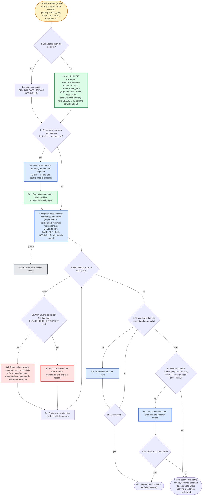

---
# performance-check budget override, not part of the diagram itself.
# This file renders one flow twice - once as pseudo-code, once as a diagram.
# Parked in assets/ and never loaded by the model, so its words cost no context.
words-budget: 2048
---

# metrics-review - flow overview

Human-facing overview for auditing the flow at a glance. Non-authoritative - the steps in [`../SKILL.md`](../SKILL.md) win on any conflict. Regenerate this file whenever the skill's flow changes.

Two renderings of the same flow, kept cross-checkable on purpose. The `# N` comments in the pseudo-code are the diagram's node ids, so an id with no matching comment is drift.

## Pseudo-code

Python-shaped for readability only; nothing here runs, and the function names stand for steps this skill performs, not real APIs.

```python
def metrics_review(base_ref_arg=None, pushed=None):          # 1 · /metrics-review, or /quality-gate section 3
    if pushed:                                               # 2
        run_dir, base_ref, session_id = pushed               # 2a · a caller pushed them in; resolve nothing twice
    else:
        run_dir = mktemp_dir("<scratchpad>/metrics-review.XXXXXX")   # 2b
        base_ref = base_ref_arg or run("resolve-base-ref.sh")   # 2b · asks which branch when detection fails
        session_id = scratchpad_segment_above("scratchpad")  # 2b

    if tool_map_has_no_entry(repo, base_ref, session_id):    # 3
        report = dispatch("Explore", "metrics-tool-inspector")   # 3a · read-only; main double-checks it
        # 3a1 · a tool no detector matches becomes a detector edit main commits

    lens = dispatch("code-reviewer", title="Metrics-lens review",
                    follow="metrics-lens.md",
                    inputs=(run_dir, base_ref, "HEAD", session_id))   # 4 · background; /tmp told writable

    # 4a · hook: check-reviewer-writes guards the lens's writes at the tool layer.
    while lens.returns_tooling_ask():                        # 5
        if nobody_can_ask():                                 # 5a · a flag or a non-cli CLAUDE_CODE_ENTRYPOINT
            answer = "defer"                                 # 5a1 · pessimistic / not measured, scored failing
        else:
            answer = ask_user("fix now or defer", recommend="defer only if the fix is not understood")   # 5b
        lens = resume_or_redispatch(lens, answer)            # 5c

    if not outputs_present_and_non_empty(run_dir):           # 6
        redispatch_once(lens)                                # 6a
        if still_missing(run_dir):                           # 6b
            return "metrics: FAIL - leg failed"              # 6b1 · never read as clean

    # 6c · main runs check-metrics-judge-coverage.py itself: every rendered
    #      Record key ruled exactly once, by a finding or a dismissal
    if run("check-metrics-judge-coverage.py", run_dir).exit != 0:
        redispatch_once(lens)                                # 6c1
        if run("check-metrics-judge-coverage.py", run_dir).exit != 0:
            return "metrics: FAIL - leg failed"              # 6c2 · same failure as 6b1

    # 7 · print both verdict paths, counts, deferred asks and detector edits;
    #     applying is /address-verdicts' job
    return run_dir
```

## Flowchart


