---
# performance-check budget override, not part of the diagram itself.
# This file renders one flow twice - once as pseudo-code, once as a diagram - so
# its size is fixed by the skill's step count, and trimming to the bundled default
# would drop steps from the flow audit or drop a whole rendering.
# Parked in assets/ and never loaded by the model, so its words cost no context.
words-budget: 4096
lines-budget: 512
---

# quality-gate - flow overview

Human-facing overview for auditing the flow at a glance. Non-authoritative - the numbered steps in [`../SKILL.md`](../SKILL.md) win on any conflict. Regenerate this file whenever the skill's flow changes.

Two renderings of the same flow, kept cross-checkable on purpose. The `# N` comments in the pseudo-code are the diagram's node ids, so an id with no matching comment is drift.

## Pseudo-code

Python-shaped for readability only; nothing here runs, and the function names stand for steps this skill performs, not real APIs.

```python
# 1 · Entry (a whole run targets 20 minutes or less; main notes each
#     phase's start and end with date +%H:%M:%S as it happens):
#     /quality-gate <spec> <plan> --tasks <ids>
#     --base-ref <ref> --auto-solve | --report-only, or
#     another skill's batch-end dispatch.
def quality_gate(arg):
    if arg.auto_solve and arg.report_only:                  # 2 · both flags passed?
        halt("--auto-solve and --report-only are a contradiction")  # 2a · STOP - not a precedence puzzle
        return

    # A flag on the command line means this run was dispatched by another
    # skill, so nobody is standing by to answer a prompt (used at 5a and 8a).
    flag_passed = arg.auto_solve or arg.report_only

    if flag_passed:                                          # 3 · either flag passed?
        mode = "auto-solve" if arg.auto_solve else "report-only"
    else:
        # 3a · Step 1 - ONE question, before anything else, so nobody is
        #      surprised by commits. Covers the refactor, auto-review,
        #      metrics and scout lenses ONLY - test-sdd is outside it,
        #      applied on every run that dispatches that leg (§5.1).
        mode = ask("report only, or auto-solve (default)?")

    # 4 · Step 2 - arg paths by their spec_/plan_ prefix, else glob the CWD.
    specs, plans = resolve_spec_and_plan(arg)
    if len(specs) > 1 or len(plans) > 1:                     # 5 · multi-match?
        if flag_passed:                                      # 5a · nobody standing by?
            # 5b · Nobody is standing by, so a prompt would stall a
            #      batch-end caller forever. Drop the multi-matched
            #      kind and say so, exactly as a zero match resolves.
            specs, plans = drop_multi_matched_kind(specs, plans)
        else:
            specs, plans = ask_numbered_list(specs, plans)   # 5c · §1 already asked, so a human stands by

    in_git = inside_git_repo()                               # 6 · a git repo encloses CWD?
    if not in_git:
        # 6a · skip base-ref resolution and NEVER stop; only the metrics
        #      leg runs, and the merged file is named ..._no-git_<ts>.md.
        BASE_REF = None
    else:
        # 7 · Step 2 - from --base-ref when the caller passed one
        #     (/implement's batch-end tail passes BATCH_BASE_SHA that
        #     way), else resolve-base-ref.sh: origin/HEAD, then local
        #     main, then local master.
        BASE_REF = arg.base_ref or sh("~/.claude/scripts/resolve-base-ref.sh")
        if base_ref_detection_failed(BASE_REF):              # 8 · detection failed?
            if flag_passed:                                  # 8a · nobody standing by?
                halt("base ref detection failed")            # 8b · no safe default the way a missing spec has
                return
            BASE_REF = ask("which branch to diff against?")  # 8c · ask which branch

    # ---- Step 3 - mint the run directory FIRST, export the pending scouts,
    #      then dispatch every leg in the SAME turn. ----
    run_dir = sh("mktemp -d /tmp/quality-gate.XXXXXX")       # 9 · minted before any dispatch; step 4.1 reuses it
    # 10 · export-open-scouts.py <SESSION_ID> run_dir/open-scouts.md prints
    #      the count of pending [Scout] tasks.
    rc, out, err = sh_rc(f"~/.claude/scripts/export-open-scouts.py {session_id} {run_dir}/open-scouts.md")
    open_scouts = None
    if rc != 0:                                              # 10a · export failed?
        # 10b · the scout leg is not dispatched; a failing outcome, never a clean one
        scout_report = f"scout leg: FAIL (export exited {rc}: {err})"
    else:
        open_scouts = int(out)
        if open_scouts == 0:                                 # 11 · no pending scout?
            # 11a · the scout leg is not dispatched; a missing task directory is
            #       reported apart, so a wrong session id never reads as "no pending scout"
            scout_report = ("scout leg: not run (no pending scout)" if exists(f"~/.claude/tasks/{session_id}/")
                            else f"scout leg: not run (no task directory for session {session_id})")

    # Independent report-only passes, no ordering between them. Each leg IS
    # the fresh-context reviewer, so none of them spawns a nested one.
    legs = dispatch_parallel(background=True, legs=[
        ("code-reviewer", "refactor",    "refactor/SKILL.md",    f"verdict_refactor_{branch}_{ts}.md"),      # 12a · leg dispatch
        ("code-reviewer", "auto-review", "auto-review/SKILL.md", f"verdict_auto-review_{branch}_{ts}.md"),   # 12b · leg dispatch
        # 12c · scoped by --tasks, passed --out-dir run_dir, dispatched ONLY when a plan resolved.
        ("test-reviewer", "test-sdd",    "test-sdd/SKILL.md",    f"{run_dir}/verdict_test-sdd_{branch}_{ts}.md"),
        # 12d · scout-leg.md: classifies each pending scout in-goal or off-goal, writes a
        #       finding per in-goal scout; dispatched ONLY when open_scouts > 0. Report-only:
        #       it writes just the two files below and never edits the TaskList.
        ("code-reviewer", "scout",       "references/scout-leg.md", f"{run_dir}/scout-leg_{ts}.md + scout-classification.md"),
        # 12e · the metrics-review skill, run by MAIN, dispatches the lens agent
        #       (metrics-review/references/metrics-lens.md) with run_dir, BASE_REF and HEAD;
        #       runs the script with --mutation; runs plan-less too; a read-only
        #       metrics-tool-inspector (Explore) runs only when the per-session
        #       tool map has no entry for this repo. refactor and auto-review get no --metrics flag.
        #       Then main runs check-metrics-judge-coverage.py on the judge file;
        #       a non-zero exit after one re-dispatch fails the leg.
        ("code-reviewer", "metrics",     "metrics-review",       f"{run_dir}/verdict_metrics_{ts}.md + metrics-judge_{ts}.md"),
    ] if in_git else [metrics_leg_only])
    # 12f · hook: check-reviewer-writes. Each leg is told /tmp is writable,
    #      or it skips the $work_dir persistence its compaction-resume needs.
    # 12g · a leg's tooling ask is raised by MAIN, never the subagent:
    #      12h · a flag, or a non-cli CLAUDE_CODE_ENTRYPOINT, means nobody can
    #            answer, so it is deferred (pessimistic / not measured);
    #      12i · otherwise AskUserQuestion fix now or defer; "fix now" resumes
    #            the leg only after the fixed tool runs.

    for leg in legs:                                         # 13 · Step 4
        if not present_and_non_empty(leg.verdict_path):
            redispatch_once(leg)                             # 13a
            if still_missing(leg):
                flag(leg)   # 13a · the other legs still stand; a failed metrics leg reads "FAIL - leg failed"
        # 13a · never report from a capped return message - always from the file

    # ---- 14 · Step 4.1 - merge the legs' files into ONE verdict.
    #      Runs on report-only and auto-solve alike, and over a single
    #      surviving file too, so the shape and lens tags are uniform. ----
    rendered = first(run_dir, "verdict_metrics_*.md", "verdict_quality-gate_no-git_*.md")        # copied verbatim and FIRST: deferred/tooling/exception entries 1..k, no severity tag; record bullets unnumbered
    sources = [l.verdict_path for l in (refactor_leg, auto_review_leg, test_sdd_leg, scout_leg, judge_file)
               if present_and_non_empty(l.verdict_path)]     # + run_dir/detector-edits.md when main committed one
    merged = None
    if not sources and not rendered:
        pass                                                 # 14a · no leg produced a file - skip the step
    else:
        merged_path = sh('date "+verdict_quality-gate_<branch>_%Y-%m-%d_%H:%M.md"')   # or ..._no-git_<ts>.md
        # 14b · main counts each source's findings itself, fence-aware (awk),
        #       BEFORE dispatching; k = the rendered file's numbered deferred,
        #       tooling-ask and exception entries (0 with none), never a record bullet.
        #       The agent's own input counts are never trusted. ONE fresh
        #       code-reviewer, foreground, given exactly the source paths
        #       (never a glob), k, and references/merge-review-verdicts.md.
        #       It writes ONLY run_dir/merged-findings.md, numbered from k+1,
        #       and a scout merged into another leg's finding hands over its
        #       **Scout task**: #<id> line.
        k = count_findings_fence_aware(rendered)
        input_counts = {s: count_findings_fence_aware(s) for s in sources}
        dispatch_foreground("code-reviewer", sources, k, f"{run_dir}/merged-findings.md", "merge-review-verdicts.md")
        # 14c · main assembles; a killed write leaves no partial verdict.
        sh(f"cat {rendered} {run_dir}/merged-findings.md | write-atomically.py {merged_path}")
        if merge_verified(merged_path, sources, k):          # 14d · main checks, without reading the file
            # 14d · non-empty, checker exit 0 on merged-findings.md alone,
            #       count == k + summed input_counts minus findings absorbed,
            #       and an awk gsub
            #       count on the WHOLE file finds no heading without exactly
            #       one of auto-review|refactor|test-sdd|metrics|scout.
            move(refactor_and_auto_review_files, run_dir)    # 14e · never delete; record moved paths for the report
            merged = merged_path
            # 14f · delete each in-goal scout task named by a **Scout task**: #<id>
            #       line (TaskUpdate status deleted); an in-goal id with no such
            #       line stays in the TaskList and the report names it.
            for task_id in scout_task_lines(merged):
                task_update(task_id, status="deleted")
        else:
            move(merged_path, run_dir)                       # 14g · fallback: every source file goes back to CWD
            # 14g · as this run's output, no scout task is deleted, and the report says so.

    # ---- Step 4.2 - the Fix-or-Skip judge, auto-solve only ----
    if mode == "auto-solve":                                 # 15 · auto-solve?
        if not merged:                                       # 15a · did the merge pass?
            judge_report = "judge: not run (merge fell back)"     # 15b · apply test-sdd only
        else:
            # 15c · main copies the merged file to run_dir/pre-judge.md, then
            #       dispatches ONE code-reviewer (foreground) with fix-judge.md §1.
            #       It rules refactor, auto-review, metrics and [scout]
            #       findings Fix or Skip, appending a Standards check line.
            copy(merged, f"{run_dir}/pre-judge.md")
            dispatch_foreground("code-reviewer", merged, "fix-judge.md#1")
            if not judge_checks_pass(merged):                # 15d · no line deleted, apply-list check, body checker
                # 15e · restore: cat pre-judge.md | write-atomically.py merged,
                #       then re-dispatch the judge ONCE with the failure output.
                restore(merged, f"{run_dir}/pre-judge.md")
                dispatch_foreground("code-reviewer", merged, "fix-judge.md#1")
                if not judge_checks_pass(merged):            # 15f · still failing?
                    restore(merged, f"{run_dir}/pre-judge.md")    # 15g · apply test-sdd only; no
                    judge_report = "judge: FAIL (<reason>)"       #       fallback apply of the other lenses

    # ---- 16 · Step 5 - assemble the apply list. Compose the whole list
    #      before invoking or printing anything; two groups enter on
    #      different terms. ----
    apply_list = []
    if plans and merged_or_test_sdd_file_has_test_sdd_findings:
        # 16a · Step 5.1 - every finding get-test-sdd-dispatch-list.py
        #       prints (run on the merged file) enters unconditionally, on a
        #       report-only run exactly as on an auto-solve one. No triage
        #       runs: the plan already declared the test, and the human
        #       already approved the plan. A planned test whose target is
        #       prose still enters, and address-verdicts annotates it SKIPPED.
        #       The script omits the unplanned-tests finding; the report
        #       step lists that one for the human to mark [Done].
        apply_list += get_test_sdd_dispatch_list(merged or test_sdd_leg.verdict_path)

    if mode == "auto-solve":                                 # 16b · Step 5.2 - mode?
        # 16d · the numbers get-fix-apply-list.py prints for the judge's Fix
        #       rulings (refactor, auto-review, metrics and scout findings);
        #       no rendered metrics section enters, only [metrics] judge findings.
        apply_list += get_fix_apply_list(merged)
    else:
        # 16c · Report-only - nothing else contributes, including
        #       findings that look trivially safe. The opt-in came from
        #       §1, and its absence is an answer.
        pass
    print(apply_list)                                        # 16e · the whole list, one line per finding, before applying

    if not apply_list:                                       # 17 · apply list empty?
        # a run with nothing to apply skips §6 entirely and
        # closes straight from what this run resolved.
        return report(ledger=None)

    # ---- 18 · Step 6 - hand the WHOLE apply list to /address-verdicts in
    #      ONE invocation, never one call per lens. APPLYING IS NOT THIS
    #      SKILL'S JOB - that skill is the one apply step for every
    #      verdict_*.md on disk; this skill only decides WHICH findings
    #      deserve a fix. Runs IN THIS SESSION rather than in a subagent:
    #      it commits the refactor agent's work (permission prompts only
    #      render in the main session), and its per-finding apply agents
    #      are already fresh-context subagents, so wrapping it would spend
    #      one of four spawn-depth levels on a layer that decides nothing. ----
    test_cmd = resolve_test_command()                        # 18a · nothing left for the callee to guess
    ledger = skill("address-verdicts",                       # 18b · invoked in this session
                   findings=apply_list,                       # 18c · explicit ids plus file paths (the merged file's for merged findings), never a severity floor
                   no_ask=True,                                # 18d · nobody is standing by, on either mode
                   test_cmd=test_cmd)                          # 18e · nothing left to infer
    # 18f · a scout found while applying goes to the TaskList; the next
    #       gate run exports it, and the scout leg never re-runs in this run.
    # 18g · it owns the TaskList seeding, the lens routing, the per-finding
    #       verify, the commit, and the [Done] / APPLIED / SKIPPED annotation.

    # 19 · Step 6.1 - the fix review over every applied commit is DISABLED
    #      since 2026-11-17 (the user is finding out what makes a run slow).
    #      Skipped; the report says "fix review: disabled". The step's text
    #      stays in SKILL.md until the user re-enables it.

    # 20 · Step 7 - close with a report that OPENS with a timing table
    #      (phase, start, end, minutes) built from the start/end times main
    #      noted per phase: last row = total vs the 20-minute target,
    #      slowest phase named. Then read references/final-report.md and
    #      report each item it lists: verdict paths, metrics results, applied
    #      findings with SHAs, judge Skips with their Standards check,
    #      never-judged findings on a report-only run, judge and fix-review
    #      status, [QUESTION] findings, the unplanned-tests finding for the
    #      human to mark [Done], what /address-verdicts skipped or failed,
    #      and the scout leg: deleted, completed and kept in-goal ids, off-goal
    #      ids left in the TaskList (ids only), a merge fallback, or "not run (no pending scout)".
    return report(ledger)
```

## Flowchart

```mermaid
flowchart TD
  n1(["1. A whole run targets 20 minutes or less; main notes each<br/>phase's start and end (date +%H:%M:%S) as it happens<br/><br/>/quality-gate &lt;spec&gt; &lt;plan&gt;<br/>--tasks &lt;ids&gt; --base-ref &lt;ref&gt;<br/>--auto-solve | --report-only<br/><br/>or another skill's batch-end dispatch"]):::start
  n2{"2. Both --auto-solve and<br/>--report-only passed?"}
  n2a(["2a. STOP - contradiction, not a<br/>precedence puzzle. Print and halt."])
  n3{"3. Either --auto-solve or<br/>--report-only passed?"}
  n3a["3a. Step 1 · ONE question, before anything else:<br/>report only or auto-solve (default)?<br/>Covers the refactor, auto-review, metrics and scout lenses ONLY -<br/>test-sdd is outside it, applied on every run that<br/>dispatches that leg regardless of the answer (§5.1)"]:::gate
  n4["4. Step 2 · Resolve spec + plan: arg paths by<br/>spec_/plan_ prefix, else glob CWD"]
  n5{"5. More than one spec, or more than one plan?"}
  n5a{"5a. Either flag passed on the<br/>command line? (nobody standing by)"}
  n5b["5b. Drop the multi-matched kind and say so,<br/>exactly as a zero match resolves.<br/>A prompt here would stall a batch-end caller forever"]
  n5c["5c. Prompt with a numbered list;<br/>the user picks which files feed the run.<br/>§1 already asked, so a human stands by"]:::gate
  n6{"6. Does a git repo enclose CWD?"}
  n6a["6a. No git - skip base-ref resolution, NEVER stop.<br/>Only the metrics leg runs; the merged file is<br/>verdict_quality-gate_no-git_&lt;ts&gt;.md"]:::state
  n7["7. Step 2 · Resolve BASE_REF from --base-ref when the<br/>caller passed one (/implement's batch-end tail passes<br/>BATCH_BASE_SHA that way), else resolve-base-ref.sh:<br/>origin/HEAD, then local main, then local master"]
  n8{"8. Base ref detection failed<br/>(none of the three found)?"}
  n8a{"8a. Either flag passed on the<br/>command line? (nobody standing by)"}
  n8b(["8b. STOP the run and print what failed -<br/>no safe default the way a missing spec has"])
  n8c["8c. Ask which branch to diff against"]:::gate

  n9["9. Step 3 · Mint RUN_DIR (mktemp -d /tmp/quality-gate.XXXXXX)<br/>BEFORE any dispatch; step 4.1 reuses it"]:::state
  n10["10. Run export-open-scouts.py with the session id and<br/>RUN_DIR/open-scouts.md; it prints the count of<br/>pending Scout tasks in the TaskList"]:::hook
  n10a{"10a. Export exited non-zero?"}
  n10b["10b. Do not dispatch the scout leg;<br/>the report reads scout leg: FAIL (export exited rc: its stderr)"]
  n11{"11. Count is 0?"}
  n11a["11a. Do not dispatch the scout leg; the report reads<br/>scout leg: not run (no pending scout), or not run (no task directory<br/>for session id) when ~/.claude/tasks/id/ does not exist"]

  subgraph legs["12. Step 3 · Dispatch every leg in the SAME turn - independent report-only passes, no ordering between them. Each leg IS the fresh-context reviewer, so none spawns a nested one."]
    direction TB
    n12a["12a. code-reviewer · reads refactor/SKILL.md (no --metrics)<br/>(agent-pinned, background, ∥)<br/>→ verdict_refactor_&lt;ts&gt;.md"]:::dispatch
    n12b["12b. code-reviewer · reads auto-review/SKILL.md (no --metrics)<br/>(agent-pinned, background, ∥)<br/>→ verdict_auto-review_&lt;ts&gt;.md"]:::dispatch
    n12c["12c. test-reviewer · reads test-sdd/SKILL.md,<br/>scoped by --tasks, passed --out-dir RUN_DIR<br/>(agent-pinned, background, ∥)<br/>→ RUN_DIR/verdict_test-sdd_&lt;ts&gt;.md<br/>ONLY when a plan resolved"]:::dispatch
    n12d["12d. code-reviewer · follows references/scout-leg.md<br/>(agent-pinned, background, ∥): classifies each pending scout<br/>in-goal or off-goal (in doubt, off-goal), verifies in-goal ones<br/>against the code, report-only<br/>→ RUN_DIR/scout-leg_&lt;ts&gt;.md + scout-classification.md<br/>ONLY when the export count is above 0"]:::dispatch
    n12e["12e. Main runs the metrics-review skill (no-git or not, plan or no plan),<br/>which dispatches the read-only metrics-tool-inspector (Explore) only when the<br/>per-session tool map has no entry for this repo, then a code-reviewer<br/>following metrics-lens.md (script run with --mutation) with RUN_DIR, BASE_REF, HEAD<br/>(background, ∥) → RUN_DIR/verdict_metrics_&lt;ts&gt;.md + metrics-judge_&lt;ts&gt;.md.<br/>Main runs check-metrics-judge-coverage.py on the judge file;<br/>non-zero after one re-dispatch fails the leg.<br/>Main double-checks the inspector's report and commits any detector edit"]:::dispatch
  end

  n12f["12f. Hook: check-reviewer-writes.<br/>Each leg is told /tmp is writable, or it skips<br/>the $work_dir persistence its compaction-resume needs"]:::hook
  n12g{"12g. Does a leg report a tooling ask?<br/>MAIN raises it, never the subagent"}
  n12h["12h. A flag, or a non-cli CLAUDE_CODE_ENTRYPOINT: nobody can ask.<br/>Defer - CRAP reads pessimistic, tooling deferred;<br/>no-entry language reads not measured: no language entry"]:::gate
  n12i["12i. AskUserQuestion: fix now or defer.<br/>Fix now resumes the leg only after the fixed tool runs;<br/>a failed fix asks again"]:::gate
  n13{"13. Step 4 · Each leg's verdict file<br/>present and non-empty?"}
  n13a["13a. Re-dispatch that leg ONCE; still missing,<br/>flag it and let the others stand.<br/>Never report from a capped return message"]:::dispatch

  subgraph merge["14. Step 4.1 · Merge the legs' files into ONE verdict_quality-gate_&lt;branch&gt;_&lt;ts&gt;.md (or ..._no-git_&lt;ts&gt;.md) - on report-only and auto-solve runs alike."]
    direction TB
    n14{"14. Did any leg produce a file?"}
    n14a["14a. None did - skip the merge.<br/>A failed metrics leg is reported as<br/>metrics: FAIL - leg failed (reason), never clean"]
    n14b["14b. Record the source paths (refactor, auto-review, test-sdd,<br/>scout-leg, judge file, detector-edits); k = main's fence-aware<br/>count of the rendered metrics verdict's numbered deferred,<br/>tooling-ask and exception entries (0 with none; record bullets never count).<br/>Main counts each source's findings itself.<br/>Dispatch ONE code-reviewer (fresh context, foreground) with<br/>exactly those paths - never a glob - k and<br/>references/merge-review-verdicts.md. It merges reports only<br/>and writes ONLY RUN_DIR/merged-findings.md, numbered from k+1;<br/>a scout absorbed into another finding hands over its Scout task line"]:::dispatch
    n14c["14c. Main assembles: cat rendered merged-findings.md<br/>| write-atomically.py merged path. The rendered file goes<br/>verbatim and FIRST; a killed write leaves no partial verdict"]:::state
    n14d{"14d. Main verifies without reading the file:<br/>non-empty, checker exit 0 on merged-findings.md alone,<br/>count == k + input counts minus absorbed,<br/>no heading without exactly one of<br/>auto-review, refactor, test-sdd, metrics, scout (fence-aware)?"}
    n14e["14e. Pass - MOVE (never delete) the refactor and auto-review<br/>files into RUN_DIR so address-verdicts cannot apply<br/>a finding from the merge and its source.<br/>Record the moved paths for the report"]:::state
    n14f["14f. Delete each in-goal scout task named by a<br/>Scout task line in the merged file (TaskUpdate status deleted).<br/>An in-goal id with no such line stays in the TaskList<br/>and the report names it"]:::state
    n14g["14g. Fail - every source file goes back to CWD as this run's<br/>output; move the failed merged file into RUN_DIR<br/>instead; no scout task is deleted; say so in the report"]:::gate
    n14 -->|"no"| n14a
    n14 -->|"yes"| n14b --> n14c --> n14d
    n14d -->|"yes"| n14e --> n14f
    n14d -->|"no"| n14g
  end

  subgraph judge["15. Step 4.2 · Fix-or-Skip judge - auto-solve only, when the merge passed"]
    direction TB
    n15{"15. Mode is auto-solve?"}
    n15a{"15a. Did the merge pass (no fallback)?"}
    n15b["15b. judge: not run (merge fell back) -<br/>apply test-sdd only"]:::gate
    n15c["15c. Main copies the merged file to RUN_DIR/pre-judge.md, then<br/>dispatches ONE code-reviewer (fresh context, foreground) with<br/>fix-judge.md §1. It rules every refactor, auto-review,<br/>metrics and scout finding Fix or Skip, appending a Standards check line"]:::dispatch
    n15d{"15d. Main's checks pass: no line deleted or changed,<br/>get-fix-apply-list.py --check exits 0,<br/>finding-body checker exits 0 on the Findings slice?"}
    n15e["15e. Restore pre-judge.md over the merged file<br/>(cat pre-judge.md | write-atomically.py merged),<br/>then re-dispatch the judge ONCE with the failure output"]:::dispatch
    n15f{"15f. Checks pass now?"}
    n15g["15g. Restore pre-judge.md again, apply test-sdd only,<br/>report judge: FAIL (reason). No fallback apply of the<br/>other lenses; fix the judge, then re-run"]:::gate
    n15 -->|"yes"| n15a
    n15a -->|"no"| n15b
    n15a -->|"yes"| n15c --> n15d
    n15d -->|"no"| n15e --> n15f
    n15f -->|"no"| n15g
  end

  subgraph applylist["16. Step 5 · Assemble the apply list - compose the whole list before invoking or printing anything. Two groups enter on different terms."]
    direction TB
    n16a["16a. Step 5.1 · Every finding get-test-sdd-dispatch-list.py<br/>prints (run on the merged file) enters the apply list<br/>UNCONDITIONALLY, whenever that leg was dispatched (a plan<br/>resolved) - report-only exactly as auto-solve. No triage: the<br/>plan already declared it, the human already approved the plan.<br/>A planned test over prose still enters; address-verdicts marks it SKIPPED.<br/>The script omits the unplanned-tests finding - it is reported<br/>for the human to mark Done, never applied"]
    n16b{"16b. Step 5.2 · Mode == auto-solve?"}
    n16c["16c. Report-only - nothing else contributes,<br/>including trivially-safe findings.<br/>The opt-in came from §1; its absence is an answer"]
    n16d["16d. Auto-solve - add the numbers get-fix-apply-list.py prints<br/>for the judge's Fix rulings across refactor, auto-review,<br/>metrics and scout findings. No rendered metrics section<br/>enters; metrics enter only as [metrics] judge findings"]
    n16e["16e. Print the composed list, one finding per line,<br/>before applying anything"]
    n16a --> n16b
    n16b -->|"report-only"| n16c --> n16e
    n16b -->|"auto-solve"| n16d --> n16e
  end

  n17{"17. Step 6 · Apply list empty?"}

  subgraph delegate["18. Step 6 · Hand the WHOLE apply list to /address-verdicts in ONE invocation - never one call per lens. Applying is NOT this skill's job: that skill is the one apply step for every verdict_*.md on disk; this skill only decides WHICH findings deserve a fix."]
    direction TB
    n18a["18a. Resolve the repo's test command<br/>(package.json script, Makefile target, its CLAUDE.md)<br/>so the callee has nothing left to guess about"]
    n18b["18b. Invoke /address-verdicts IN THIS SESSION,<br/>never wrapped in a subagent: it commits the refactor<br/>agent's work and permission prompts render only in the<br/>main session; and its apply agents are already<br/>fresh-context subagents, so wrapping it spends one of<br/>four spawn-depth levels on nothing"]:::skill
    n18c["18c. Pass the apply list as EXPLICIT ids with their<br/>verdict file paths (the merged file's for merged findings),<br/>never a severity floor - nothing re-derives<br/>the triage and quietly widens the scope"]
    n18d["18d. Pass --no-ask: nobody is standing by,<br/>on either mode, and a prompt mid-batch would<br/>stall a batch-end caller indefinitely"]:::gate
    n18e["18e. Pass --test-cmd, so its own inference<br/>step has nothing left to guess"]
    n18f["18f. A scout found while applying goes to the TaskList;<br/>the next gate run exports it. The scout leg never<br/>re-runs in this run, so the run never loops"]:::state
    n18g["18g. It owns the TaskList seeding, the lens routing,<br/>the per-finding verify, the commit, and the<br/>[Done] / APPLIED / SKIPPED annotation"]:::state
    n18a --> n18b --> n18c --> n18d --> n18e --> n18f --> n18g
  end

  n19["19. Step 6.1 · Fix review over every applied commit:<br/>DISABLED since 2026-11-17 while the user finds out what<br/>makes a run slow. Skip it; the report says<br/>fix review: disabled"]:::gate
  n20(["20. Step 7 · Close with a report that opens with a timing table<br/>(phase, start, end, minutes; last row = total vs the 20-minute<br/>target, slowest phase named). Then read references/final-report.md<br/>and report each item it lists: verdict paths, metrics results,<br/>applied findings with SHAs, judge Skips, never-judged findings on a<br/>report-only run, judge and fix-review status, QUESTION findings,<br/>the unplanned-tests finding for the human to mark Done,<br/>what /address-verdicts skipped or failed, and the scout leg:<br/>deleted, completed and kept in-goal ids, off-goal ids left in<br/>the TaskList (ids only), a merge fallback, or not run (no pending scout)"])

  n1 --> n2
  n2 -->|"yes"| n2a
  n2 -->|"no"| n3
  n3 -->|"yes"| n4
  n3 -->|"no"| n3a --> n4
  n4 --> n5
  n5 -->|"no"| n6
  n5 -->|"yes"| n5a
  n5a -->|"yes"| n5b --> n6
  n5a -->|"no"| n5c --> n6
  n6 -->|"no"| n6a --> n9
  n6 -->|"yes"| n7 --> n8
  n8 -->|"no"| n9
  n8 -->|"yes"| n8a
  n8a -->|"yes"| n8b
  n8a -->|"no"| n8c --> n9
  n9 --> n10 --> n10a
  n10a -->|"yes"| n10b
  n10a -->|"no"| n11
  n10b --> n12a
  n10b --> n12b
  n10b --> n12c
  n10b --> n12e
  n11 -->|"yes"| n11a
  n11 -->|"no"| n12d
  n11a --> n12a
  n11a --> n12b
  n11a --> n12c
  n11a --> n12e
  n12d -.->|"guards"| n12f
  n12a -.->|"guards"| n12f
  n12b -.->|"guards"| n12f
  n12c -.->|"guards"| n12f
  n12e -.->|"guards"| n12f
  n12e --> n12g
  n12g -->|"no ask"| n13
  n12g -->|"ask, nobody can answer"| n12h --> n13
  n12g -->|"ask, a human can"| n12i --> n13
  n12a --> n13
  n12b --> n13
  n12c --> n13
  n12d --> n13
  n13 -->|"yes"| n14
  n13 -->|"no"| n13a --> n14
  n14a --> n15
  n14f --> n15
  n14g --> n15
  n15 -->|"no"| n16a
  n15b --> n16a
  n15d -->|"yes"| n16a
  n15f -->|"yes"| n16a
  n15g --> n16a
  n16e --> n17
  n17 -->|"yes"| n20
  n17 -->|"no"| n18a
  n18g --> n19 --> n20

  classDef start fill:#fef3c7,stroke:#d97706,stroke-width:2px
  classDef gate fill:#fee2e2,stroke:#dc2626,stroke-width:2px
  classDef dispatch fill:#dbeafe,stroke:#2563eb,stroke-width:2px
  classDef state fill:#dcfce7,stroke:#16a34a,stroke-width:2px
  classDef skill fill:#f3e8ff,stroke:#9333ea,stroke-width:2px
  classDef hook fill:#e5e7eb,stroke:#4b5563,stroke-width:2px
```


