---
# performance-check budget override, not part of the diagram itself.
# This file renders one flow twice - once as pseudo-code, once as a diagram - so
# its size is fixed by the skill's step count, and trimming to the bundled default
# would drop steps from the flow audit or drop a whole rendering.
# Parked in assets/ and never loaded by the model, so its words cost no context.
words-budget: 4096
lines-budget: 512
---

# quality-gate - flow overview

Human-facing overview for auditing the flow at a glance. Non-authoritative - the numbered steps in [`../SKILL.md`](../SKILL.md) win on any conflict. Regenerate this file whenever the skill's flow changes.

Two renderings of the same flow, kept cross-checkable on purpose. The `# N` comments in the pseudo-code are the diagram's node ids, so an id with no matching comment is drift.

## Pseudo-code

Python-shaped for readability only; nothing here runs, and the function names stand for steps this skill performs, not real APIs.

```python
# 1 · Entry (a whole run targets 20 minutes or less; main notes each
#     phase's start and end with date +%H:%M:%S as it happens):
#     /quality-gate <spec> <plan> --tasks <ids>
#     --base-ref <ref> --auto-solve | --report-only, or
#     another skill's batch-end dispatch.
def quality_gate(arg):
    if arg.auto_solve and arg.report_only:                  # 2 · both flags passed?
        halt("--auto-solve and --report-only are a contradiction")  # 2a · STOP - not a precedence puzzle
        return

    # A flag on the command line means this run was dispatched by another
    # skill, so nobody is standing by to answer a prompt (used at 5x and 7x).
    flag_passed = arg.auto_solve or arg.report_only

    if flag_passed:                                          # 3 · either flag passed?
        mode = "auto-solve" if arg.auto_solve else "report-only"
    else:
        # 3a · Step 1 - ONE question, before anything else, so nobody is
        #      surprised by commits. Covers the refactor and auto-review
        #      lenses ONLY - test-sdd is outside it, applied on every run
        #      that dispatches that leg regardless of the answer (§5.1).
        mode = ask("report only (default), or auto-solve?")

    # 4 · Step 2 - arg paths by their spec_/plan_ prefix, else glob the CWD.
    specs, plans = resolve_spec_and_plan(arg)
    if len(specs) > 1 or len(plans) > 1:                     # 5 · multi-match?
        if flag_passed:                                      # 5x · nobody standing by?
            # 5a · Nobody is standing by, so a prompt would stall a
            #      batch-end caller forever. Drop the multi-matched
            #      kind and say so, exactly as a zero match resolves.
            specs, plans = drop_multi_matched_kind(specs, plans)
        else:
            specs, plans = ask_numbered_list(specs, plans)   # 5b · §1 already asked, so a human stands by

    # 6 · Step 2 - from --base-ref when the caller passed one
    #     (/implement's batch-end tail passes BATCH_BASE_SHA that
    #     way), else resolve-base-ref.sh: origin/HEAD, then local
    #     main, then local master.
    in_git = inside_git_repo()                               # 6x · a git repo encloses CWD?
    if not in_git:
        # 6y · skip base-ref resolution and NEVER stop; only the metrics
        #      leg runs, and the merged file is named ..._no-git_<ts>.md.
        BASE_REF = None
    else:
        BASE_REF = arg.base_ref or sh("~/.claude/scripts/resolve-base-ref.sh")
        if base_ref_detection_failed(BASE_REF):              # 7 · detection failed?
            if flag_passed:                                  # 7x · nobody standing by?
                halt("base ref detection failed")            # 7a · no safe default the way a missing spec has
                return
            BASE_REF = ask("which branch to diff against?")  # 7b · ask which branch

    # ---- 8 · Step 3 - mint the run directory FIRST, then dispatch every
    #      leg in the SAME turn. Independent report-only passes, no ordering
    #      between them. Each leg IS the fresh-context reviewer, so none of
    #      them spawns a nested one. ----
    run_dir = sh("mktemp -d /tmp/quality-gate.XXXXXX")       # 8i · minted before any dispatch; step 4.1 reuses it
    # 8j · metrics-tool-inspector (read-only Explore) is dispatched by MAIN,
    #      only when the per-session tool map has no entry for this repo.
    legs = dispatch_parallel(background=True, legs=[
        ("code-reviewer", "refactor",    "refactor/SKILL.md",    f"verdict_refactor_{branch}_{ts}.md"),      # 8a · leg dispatch
        ("code-reviewer", "auto-review", "auto-review/SKILL.md", f"verdict_auto-review_{branch}_{ts}.md"),   # 8b · leg dispatch
        # 8c · scoped by --tasks, passed --out-dir run_dir, dispatched ONLY when a plan resolved.
        ("test-reviewer", "test-sdd",    "test-sdd/SKILL.md",    f"{run_dir}/verdict_test-sdd_{branch}_{ts}.md"),
        # 8m · metrics-lens.md, with run_dir, BASE_REF and HEAD; runs the script with --mutation; runs plan-less too.
        ("code-reviewer", "metrics",     "metrics-lens.md",      f"{run_dir}/verdict_metrics_{ts}.md + metrics-judge_{ts}.md"),
    ] if in_git else [metrics_leg_only])
    # 8d · hook: check-reviewer-writes. Each leg is told /tmp is writable,
    #      or it skips the $work_dir persistence its compaction-resume needs.
    # 8k · a leg's tooling ask is raised by MAIN, never the subagent:
    #      asked unless a flag or a non-cli CLAUDE_CODE_ENTRYPOINT means
    #      nobody can answer, then deferred (pessimistic / not measured).
    #      "fix now" resumes the leg only after the fixed tool runs.

    for leg in legs:                                         # 9 · Step 4
        if not present_and_non_empty(leg.verdict_path):
            redispatch_once(leg)                             # 9a
            if still_missing(leg):
                flag(leg)   # 9a · the other legs still stand; a failed metrics leg reads "FAIL - leg failed"
        # 9a · never report from a capped return message - always from the file

    # ---- 10 · Step 4.1 - merge the four legs' files into ONE verdict.
    #      Runs on report-only and auto-solve alike, and over a single
    #      surviving file too, so the shape and lens tags are uniform. ----
    rendered = first(run_dir, "verdict_metrics_*.md", "verdict_quality-gate_no-git_*.md")        # copied verbatim and FIRST: entries 1..k, no severity tag
    sources = [l.verdict_path for l in (refactor_leg, auto_review_leg, test_sdd_leg, judge_file)
               if present_and_non_empty(l.verdict_path)]     # + run_dir/detector-edits.md when main committed one
    merged = None
    if not sources and not rendered:                         # 10 · any leg produced a file?
        pass                                                 # 10a · none did - skip the step
    else:
        merged_path = sh('date "+verdict_quality-gate_<branch>_%Y-%m-%d_%H:%M.md"')   # or ..._no-git_<ts>.md
        # 10b · main counts each source's findings itself, fence-aware (awk),
        #       BEFORE dispatching; k = the rendered file's count (0 with none).
        #       The agent's own input counts are never trusted.
        k = count_findings_fence_aware(rendered)
        input_counts = {s: count_findings_fence_aware(s) for s in sources}
        # 10b · ONE fresh code-reviewer, foreground, given exactly the source
        #       paths (never a glob), k, and references/merge-review-verdicts.md.
        #       It writes ONLY run_dir/merged-findings.md, numbered from k+1.
        dispatch_foreground("code-reviewer", sources, k, f"{run_dir}/merged-findings.md", "merge-review-verdicts.md")
        # 10f · main assembles; a killed write leaves no partial verdict.
        sh(f"cat {rendered} {run_dir}/merged-findings.md | write-atomically.py {merged_path}")
        if merge_verified(merged_path, sources, k):          # 10c · main checks, without reading the file
            # 10c · non-empty, checker exit 0 on merged-findings.md alone,
            #       count == k + summed input_counts minus findings absorbed
            #       (a group of k duplicates absorbs k-1), and an awk gsub
            #       count on the WHOLE file finds no heading without exactly
            #       one of auto-review|refactor|test-sdd|metrics.
            move(refactor_and_auto_review_files, run_dir)    # 10d · never delete; record moved paths for the report
            merged = merged_path
        else:
            move(merged_path, run_dir)                       # 10e · fallback: every source file goes back to CWD
            # 10e · as this run's output, and the report says so.

    # ---- 11 · Step 5 - assemble the apply list. Compose the whole list
    #      before invoking or printing anything; the three groups below enter
    #      on different terms. ----
    apply_list = []
    if plans and merged_or_test_sdd_file_has_test_sdd_findings:
        # 11a · Step 5.1 - every finding get-test-sdd-dispatch-list.py
        #       prints (run on the merged file) enters unconditionally, on a
        #       report-only run exactly as on an auto-solve one. No triage
        #       runs: the plan already declared the test, and the human
        #       already approved the plan. The script omits the
        #       unplanned-tests finding; the report step lists that one for
        #       the human to mark [Done].
        apply_list += get_test_sdd_dispatch_list(merged or test_sdd_leg.verdict_path)

    # 11c · Step 5.3 - every entry under the rendered file's "## Open
    #       violations" (fence-aware awk lists their numbers) plus every
    #       [metrics] judge finding enters, report-only and auto-solve alike:
    #       the plan approval already asked for measured quality. Ranked
    #       lists, exceptions and deferred entries stay out; so do duplication,
    #       dead code and mutant entries - only judge findings enter. A violation the
    #       fix cannot clear, or a rejected exception, stays unmarked, open
    #       and first - and never blocks the PR.
    apply_list += open_violations(rendered) + metrics_judge_findings(merged)

    if mode == "auto-solve":                                 # 11b · Step 5.2
        # 11b2 · Read the MERGED file IN FULL (the two source files on the
        #        fallback path), never the legs' return summaries; sort
        #        every finding addressable vs not; print both lists with
        #        reasons BEFORE applying. Findings are named
        #        quality-gate#N [<lens>] (<file>:<lines>), or <lens>#N (...)
        #        for test-sdd and on the fallback path.
        addressable, not_addressable = sort_findings(
            read_in_full(merged) if merged else
            read_in_full(sources),
        )
        print(addressable, not_addressable)
        apply_list += addressable
    else:
        # 11b1 · Report-only - neither lens contributes anything, including
        #        findings that look trivially safe. The opt-in came from
        #        §1, and its absence is an answer.
        pass

    if not apply_list:                                       # 12 · apply list empty?
        # a report-only run that resolved no plan has nothing to apply -
        # skip §6 entirely and close straight from what this run resolved.
        return report(ledger=None)

    # ---- 13 · Step 6 - hand the WHOLE apply list to /address-verdicts in
    #      ONE invocation, never one call per lens. APPLYING IS NOT THIS
    #      SKILL'S JOB - that skill is the one apply step for every
    #      verdict_*.md on disk; this skill only decides WHICH findings
    #      deserve a fix. Runs IN THIS SESSION rather than in a subagent:
    #      it commits the refactor agent's work (permission prompts only
    #      render in the main session), and its per-finding apply agents
    #      are already fresh-context subagents, so wrapping it would spend
    #      one of four spawn-depth levels on a layer that decides nothing. ----
    test_cmd = resolve_test_command()                        # 13a · nothing left for the callee to guess
    ledger = skill("address-verdicts",                       # 13b · invoked in this session
                   findings=apply_list,                       # 13c · explicit ids plus file paths (the merged file's for merged findings), never a severity floor
                   no_ask=True,                                # 13d · nobody is standing by, on either mode
                   test_cmd=test_cmd)                          # 13e · nothing left to infer
    # 13f · it owns the TaskList seeding, the lens routing, the per-finding
    #       verify, the commit, and the [Done] / APPLIED / SKIPPED annotation.
    # 13g · Step 6.1 - the fix review over every applied commit is DISABLED
    #       since 2026-11-17 (the user is finding out what makes a run slow).
    #       Skipped; the report says "fix review: disabled". The step's text
    #       stays in SKILL.md until the user re-enables it.

    # 14 · Step 7 - close with a report that OPENS with a timing table
    #      (phase, start, end, minutes) built from the start/end times main
    #      noted per phase (each leg, merge, judge, each /address-verdicts
    #      dispatch, report): last row = total vs the 20-minute target,
    #      slowest phase named. Then: every verdict path (the merged
    #      file, the rendered metrics verdict and judge file in run_dir, the
    #      moved source paths, the fallback if it happened, + any leg that
    #      failed to produce one - a failed metrics leg reads "metrics: not
    #      measured (<reason>)", never clean), any deferred tooling ask with
    #      its "pessimistic" / "not measured" reading, the metrics apply
    #      outcomes, applied findings with SHAs, "fix review: disabled",
    #      §5.2's not-addressable findings, /address-verdicts' skipped/failed
    #      findings, the never-dispatched unplanned-tests finding for the
    #      human to mark [Done], and - on a report-only run - every refactor and
    #      auto-review finding listed under a heading naming them as NEVER
    #      TRIAGED, closing with the two ways to work them: /address-verdicts,
    #      or a re-run as /quality-gate --auto-solve.
    return report(ledger)
```

## Flowchart

```mermaid
flowchart TD
  n1(["1. A whole run targets 20 minutes or less; main notes each<br/>phase's start and end (date +%H:%M:%S) as it happens<br/><br/>/quality-gate &lt;spec&gt; &lt;plan&gt;<br/>--tasks &lt;ids&gt; --base-ref &lt;ref&gt;<br/>--auto-solve | --report-only<br/><br/>or another skill's batch-end dispatch"]):::start
  n2{"2. Both --auto-solve and<br/>--report-only passed?"}
  n2a(["2a. STOP - contradiction, not a<br/>precedence puzzle. Print and halt."])
  n3{"3. Either --auto-solve or<br/>--report-only passed?"}
  n3a["3a. Step 1 · ONE question, before anything else:<br/>report only (default) or auto-solve?<br/>Covers the refactor and auto-review lenses ONLY -<br/>test-sdd is outside it, applied on every run that<br/>dispatches that leg regardless of the answer (§5.1)"]:::gate
  n4["4. Step 2 · Resolve spec + plan: arg paths by<br/>spec_/plan_ prefix, else glob CWD"]
  n5{"5. More than one spec, or more than one plan?"}
  n5x{"5x. Either flag passed on the<br/>command line? (nobody standing by)"}
  n5a["5a. Drop the multi-matched kind and say so,<br/>exactly as a zero match resolves.<br/>A prompt here would stall a batch-end caller forever"]
  n5b["5b. Prompt with a numbered list;<br/>the user picks which files feed the run.<br/>§1 already asked, so a human stands by"]:::gate
  n6["6. Step 2 · Resolve BASE_REF from --base-ref when the<br/>caller passed one (/implement's batch-end tail passes<br/>BATCH_BASE_SHA that way), else resolve-base-ref.sh:<br/>origin/HEAD, then local main, then local master"]
  n6x{"6x. Does a git repo enclose CWD?"}
  n6y["6y. No git - skip base-ref resolution, NEVER stop.<br/>Only the metrics leg runs; the merged file is<br/>verdict_quality-gate_no-git_&lt;ts&gt;.md"]:::state
  n7{"7. Base ref detection failed<br/>(none of the three found)?"}
  n7x{"7x. Either flag passed on the<br/>command line? (nobody standing by)"}
  n7a(["7a. STOP the run and print what failed -<br/>no safe default the way a missing spec has"])
  n7b["7b. Ask which branch to diff against"]:::gate

  n8i["8i. Mint RUN_DIR (mktemp -d /tmp/quality-gate.XXXXXX)<br/>BEFORE any dispatch; step 4.1 reuses it"]:::state
  n8j["8j. Main dispatches the read-only metrics-tool-inspector<br/>(Explore) only when the per-session tool map has<br/>no entry for this repo; main double-checks its report<br/>and commits any detector edit"]:::dispatch

  subgraph legs["8. Step 3 · Dispatch every leg in the SAME turn - independent report-only passes, no ordering between them. Each leg IS the fresh-context reviewer, so none spawns a nested one."]
    direction TB
    n8a["8a. code-reviewer · reads refactor/SKILL.md<br/>(agent-pinned, background, ∥)<br/>→ verdict_refactor_&lt;ts&gt;.md"]:::dispatch
    n8b["8b. code-reviewer · reads auto-review/SKILL.md<br/>(agent-pinned, background, ∥)<br/>→ verdict_auto-review_&lt;ts&gt;.md"]:::dispatch
    n8c["8c. test-reviewer · reads test-sdd/SKILL.md,<br/>scoped by --tasks, passed --out-dir RUN_DIR<br/>(agent-pinned, background, ∥)<br/>→ RUN_DIR/verdict_test-sdd_&lt;ts&gt;.md<br/>ONLY when a plan resolved"]:::dispatch
    n8m["8m. code-reviewer · follows metrics-lens.md<br/>(script run with --mutation) with<br/>RUN_DIR, BASE_REF, HEAD (background, ∥), plan or no plan<br/>→ RUN_DIR/verdict_metrics_&lt;ts&gt;.md + metrics-judge_&lt;ts&gt;.md"]:::dispatch
  end

  n8d["8d. Hook: check-reviewer-writes.<br/>Each leg is told /tmp is writable, or it skips<br/>the $work_dir persistence its compaction-resume needs"]:::hook
  n8k{"8k. Does a leg report a tooling ask?<br/>MAIN raises it, never the subagent"}
  n8k1["8k1. A flag, or a non-cli CLAUDE_CODE_ENTRYPOINT: nobody can ask.<br/>Defer - CRAP reads pessimistic, tooling deferred;<br/>no-entry language reads not measured: no language entry"]:::gate
  n8k2["8k2. AskUserQuestion: fix now or defer.<br/>Fix now resumes the leg only after the fixed tool runs;<br/>a failed fix asks again"]:::gate
  n9{"9. Step 4 · Each leg's verdict file<br/>present and non-empty?"}
  n9a["9a. Re-dispatch that leg ONCE; still missing,<br/>flag it and let the others stand.<br/>Never report from a capped return message"]:::dispatch

  subgraph merge["10. Step 4.1 · Merge the legs' files into ONE verdict_quality-gate_&lt;branch&gt;_&lt;ts&gt;.md (or ..._no-git_&lt;ts&gt;.md) - on report-only and auto-solve runs alike."]
    direction TB
    n10{"10. Did any leg produce a file?"}
    n10a["10a. None did - skip the merge.<br/>A failed metrics leg is reported as<br/>metrics: FAIL - leg failed (reason), never clean"]
    n10b["10b. Record the source paths; k = main's fence-aware<br/>count of the rendered metrics verdict (0 with none).<br/>Main counts each source's findings itself.<br/>Dispatch ONE code-reviewer (fresh context, foreground) with<br/>exactly those paths - never a glob - k and<br/>references/merge-review-verdicts.md. It merges reports only<br/>and writes ONLY RUN_DIR/merged-findings.md, numbered from k+1"]:::dispatch
    n10f["10f. Main assembles: cat rendered merged-findings.md<br/>| write-atomically.py merged path. The rendered file goes<br/>verbatim and FIRST; a killed write leaves no partial verdict"]:::state
    n10c{"10c. Main verifies without reading the file:<br/>non-empty, checker exit 0 on merged-findings.md alone,<br/>count == k + input counts minus absorbed (k duplicates absorb k-1),<br/>no heading without exactly one of<br/>auto-review, refactor, test-sdd, metrics (fence-aware)?"}
    n10d["10d. Pass - MOVE (never delete) the refactor and auto-review<br/>files into RUN_DIR so address-verdicts cannot apply<br/>a finding from the merge and its source.<br/>Record the moved paths for the report"]:::state
    n10e["10e. Fail - every source file goes back to CWD as this run's<br/>output; move the failed merged file into RUN_DIR<br/>instead, and say so in the report"]:::gate
    n10 -->|"no"| n10a
    n10 -->|"yes"| n10b --> n10f --> n10c
    n10c -->|"yes"| n10d
    n10c -->|"no"| n10e
  end

  subgraph applylist["11. Step 5 · Assemble the apply list - compose the whole list before invoking or printing anything. The three groups below enter on different terms."]
    direction TB
    n11a["11a. Step 5.1 · Every finding get-test-sdd-dispatch-list.py<br/>prints (run on the merged file) enters the apply list<br/>UNCONDITIONALLY, whenever that leg was dispatched (a plan<br/>resolved) - report-only exactly as auto-solve. No triage: the<br/>plan already declared it, the human already approved the plan.<br/>The script omits the unplanned-tests finding - it is reported<br/>for the human to mark Done, never applied"]
    n11c["11c. Step 5.3 · Every entry under the rendered file's<br/>Open violations (fence-aware awk lists the numbers) plus every<br/>[metrics] judge finding enters, report-only and auto-solve alike.<br/>Ranked lists, exceptions, deferred entries and<br/>duplication, dead code and mutant entries stay out.<br/>A violation the fix cannot clear, or a rejected exception,<br/>stays unmarked, open and first; nothing blocks the PR"]
    n11b{"11b. Step 5.2 · Mode == auto-solve?"}
    n11b1["11b1. Report-only - neither lens contributes anything,<br/>including trivially-safe findings.<br/>The opt-in came from §1; its absence is an answer"]
    n11b2["11b2. Auto-solve - read the MERGED file IN FULL (the two source<br/>files on the fallback path), never the legs' return summaries;<br/>sort every finding addressable vs not; print both lists with<br/>reasons BEFORE applying, each finding as<br/>quality-gate#N [lens] (file:lines), or lens#N (...) for<br/>test-sdd and on the fallback path"]
    n11a --> n11c --> n11b
    n11b -->|"report-only"| n11b1
    n11b -->|"auto-solve"| n11b2
  end

  n12{"12. Step 6 · Apply list empty?"}

  subgraph delegate["13. Step 6 · Hand the WHOLE apply list to /address-verdicts in ONE invocation - never one call per lens. Applying is NOT this skill's job: that skill is the one apply step for every verdict_*.md on disk; this skill only decides WHICH findings deserve a fix."]
    direction TB
    n13a["13a. Resolve the repo's test command<br/>(package.json script, Makefile target, its CLAUDE.md)<br/>so the callee has nothing left to guess about"]
    n13b["13b. Invoke /address-verdicts IN THIS SESSION,<br/>never wrapped in a subagent: it commits the refactor<br/>agent's work and permission prompts render only in the<br/>main session; and its apply agents are already<br/>fresh-context subagents, so wrapping it spends one of<br/>four spawn-depth levels on nothing"]:::skill
    n13c["13c. Pass the apply list as EXPLICIT ids with their<br/>verdict file paths (the merged file's for merged findings),<br/>never a severity floor - nothing re-derives<br/>the triage and quietly widens the scope"]
    n13d["13d. Pass --no-ask: nobody is standing by,<br/>on either mode, and a prompt mid-batch would<br/>stall a batch-end caller indefinitely"]:::gate
    n13e["13e. Pass --test-cmd, so its own inference<br/>step has nothing left to guess"]
    n13f["13f. It owns the TaskList seeding, the lens routing,<br/>the per-finding verify, the commit, and the<br/>[Done] / APPLIED / SKIPPED annotation"]:::state
    n13g["13g. Step 6.1 · Fix review over every applied commit:<br/>DISABLED since 2026-11-17 while the user finds out what<br/>makes a run slow. Skip it; the report says<br/>fix review: disabled"]:::gate
    n13a --> n13b --> n13c --> n13d --> n13e --> n13f --> n13g
  end

  n14(["14. Step 7 · Close with a report that opens with a timing table<br/>(phase, start, end, minutes; last row = total vs the 20-minute<br/>target, slowest phase named), built from the start and end times<br/>main noted per phase. Then: every verdict path (the merged<br/>file, the rendered metrics verdict and judge file in RUN_DIR, the moved<br/>source paths, the fallback if it happened, + any leg that failed;<br/>a failed metrics leg reads FAIL - leg failed, never clean), any deferred<br/>tooling ask with its reading, the metrics apply outcomes,<br/>applied findings with SHAs, fix review: disabled,<br/>§5.2's not-addressable findings, /address-verdicts'<br/>skipped/failed findings, the never-dispatched<br/>unplanned-tests finding for the human to mark Done, and - on a report-only run -<br/>every refactor/auto-review finding under a heading<br/>naming them NEVER TRIAGED, closing with the two ways<br/>to work them: /address-verdicts, or a re-run as<br/>/quality-gate --auto-solve"])

  n1 --> n2
  n2 -->|"yes"| n2a
  n2 -->|"no"| n3
  n3 -->|"yes"| n4
  n3 -->|"no"| n3a --> n4
  n4 --> n5
  n5 -->|"no"| n6
  n5 -->|"yes"| n5x
  n5x -->|"yes"| n5a --> n6
  n5x -->|"no"| n5b --> n6
  n6 --> n6x
  n6x -->|"no"| n6y --> n8i
  n6x -->|"yes"| n7
  n7 -->|"no"| n8i
  n7 -->|"yes"| n7x
  n7x -->|"yes"| n7a
  n7x -->|"no"| n7b --> n8i
  n8i --> n8j
  n8j --> n8a
  n8j --> n8b
  n8j --> n8c
  n8j --> n8m
  n8a -.->|"guards"| n8d
  n8b -.->|"guards"| n8d
  n8c -.->|"guards"| n8d
  n8m -.->|"guards"| n8d
  n8m --> n8k
  n8k -->|"no ask"| n9
  n8k -->|"ask, nobody can answer"| n8k1 --> n9
  n8k -->|"ask, a human can"| n8k2 --> n9
  n8a --> n9
  n8b --> n9
  n8c --> n9
  n9 -->|"yes"| n10
  n9 -->|"no"| n9a --> n10
  n10a --> n11a
  n10d --> n11a
  n10e --> n11a
  n11b1 --> n12
  n11b2 --> n12
  n12 -->|"yes"| n14
  n12 -->|"no"| n13a
  n13g --> n14

  classDef start fill:#fef3c7,stroke:#d97706,stroke-width:2px
  classDef gate fill:#fee2e2,stroke:#dc2626,stroke-width:2px
  classDef dispatch fill:#dbeafe,stroke:#2563eb,stroke-width:2px
  classDef state fill:#dcfce7,stroke:#16a34a,stroke-width:2px
  classDef skill fill:#f3e8ff,stroke:#9333ea,stroke-width:2px
  classDef hook fill:#e5e7eb,stroke:#4b5563,stroke-width:2px
```


