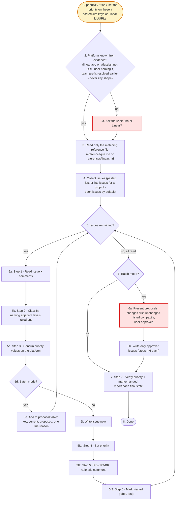

# tech-debt-prioritizer - flow overview

Human-facing overview for auditing the flow at a glance. Non-authoritative - the numbered steps in [`../SKILL.md`](../SKILL.md) win on any conflict. Regenerate this file whenever the skill's flow changes.

Two renderings of the same flow, kept cross-checkable on purpose. The `# N` comments in the pseudo-code are the diagram's node ids, so an id with no matching comment is drift.

## Pseudo-code

Python-shaped for readability only; nothing here runs, and the function names stand for steps this skill performs, not real APIs.

```python
# 1 · Entry: "prioriza", "triar", "refina esses débitos", "set the priority on these",
#     "review the priorities of this project", pasted Jira keys or Linear ids/URLs.
def tech_debt_prioritizer(issues_or_project):
    # 2 · Choosing the platform - evidence only, never key shape
    #     (ITGD-3160 and CDPI-399 look the same).
    platform = platform_from_evidence(issues_or_project)
    if platform is None:                                       # 2
        platform = ask_user("Jira or Linear?")                 # 2a · gate

    # 3 · read ONLY the matching file; the other one is never opened
    ref = read(f"references/{platform}.md")

    # 4 · batch over a project, or several issues (Linear: open issues only by default)
    issues = list_issues(issues_or_project, ref)
    batch = len(issues) > 1

    proposals = []
    for issue in issues:                                       # 5 · per-issue loop
        read_issue_and_comments(issue, ref)                    # 5a · Step 1
        level = classify_naming_adjacent_levels(issue)         # 5b · Step 2
        confirm_priority_values(platform, ref)                 # 5c · Step 3
        if batch:                                              # 5d · gate on batch mode
            proposals.append((issue, level))                   # 5e · table: key, current, proposed, reason
        else:
            write_issue(issue, level, ref)                     # 5f · write now, Steps 4-6

    if batch:                                                  # 6 · gate on batch mode
        approved = ask_user_approval(proposals)                # 6a · changes first, unchanged compact
        for issue, level in approved:                          # 6b · write only what the user approved
            write_issue(issue, level, ref)                     # Steps 4-6, same helper as 5f

    # 7 · Step 7 - verify priority + triaged marker landed, report each final state
    verify_and_report(ref)
    return  # 8 · Done


def write_issue(issue, level, ref):
    set_priority(issue, level, ref)                            # 5f1 · Step 4
    post_ptbr_comment(issue, level, ref)                       # 5f2 · Step 5
    mark_triaged(issue, ref)                                   # 5f3 · Step 6, last
```

## Flowchart


