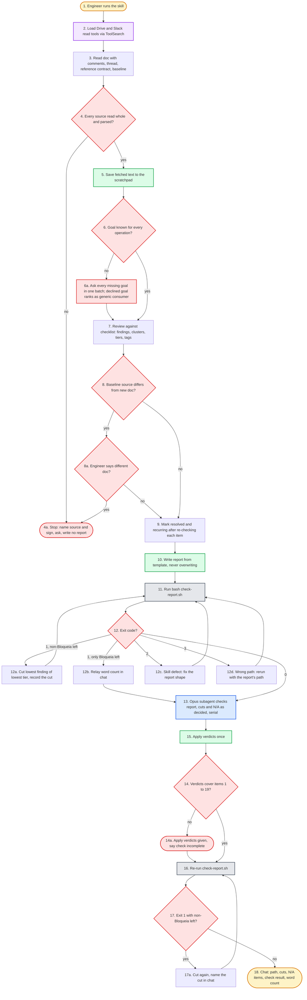

# tech-doc-review flowchart

Human-facing and non-authoritative: SKILL.md's numbered steps win on conflict.

The `# <id> ·` comments in the pseudo-code are load-bearing: each matches a diagram node id, so drift between the two renderings is something `grep` finds.

## Pseudo-code

The function names stand for orchestrator actions, not real APIs.

```python
def halt(reason):
    # 3a · stop: name the source and the sign, ask, write no report
    ask_engineer(reason)
    return

# 1 · engineer runs the skill with doc, context, optional reference contract, optional last report
load_read_tools_via_toolsearch()                      # 2 · read-only Drive and Slack tools, by function
sources = read(doc_with_comments, thread, reference, baseline)   # 3 ·
if not every_source_whole_and_parsed(sources):        # 4 · incl. JSON/YAML parse, xlsx tab count
    return halt("unreadable, incomplete, unparseable or ambiguous source")  # 4a ·
save_text_to_scratchpad(sources)                      # 5 · checker reads the same bytes
missing = operations_without_goal()                   # 6 ·
if missing:
    ask_engineer_in_one_batch(missing)                # 6a ·
findings = review_against_checklist()                 # 7 · clusters, tiers, tags, baseline match
if baseline:
    if source_line_differs():                         # 8 ·
        if engineer_says_different_doc():             # 8a ·
            return halt("different doc, no report")
    findings = mark_resolved_and_recurring(findings)  # 9 · re-check item at its places first
report = write_report_from_template(findings)         # 10 · never overwrite
rc = check_report(report)                             # 11 ·
while rc != 0:                                        # 12 · exit code
    if rc == 1 and non_bloqueia_left(report):
        cut_lowest_finding_of_lowest_tier(report)     # 12a · record the cut
    elif rc == 1:
        relay_word_count_in_chat()                    # 12b · only Bloqueia left, kept
        break
    elif rc == 2:
        fix_report_shape(report)                      # 12c · skill defect
    else:
        report = rerun_with_report_path()             # 12d · exit 3: wrong, missing or unreadable path
    rc = check_report(report)
verdicts = opus_check(report)                         # 13 · general-purpose, once per run
apply_verdicts_once(report, verdicts)                 # 15 · the verdicts it gave, no second check
if not covers_items_1_to_19(verdicts):                # 14 ·
    say_in_chat("check incomplete")                   # 14a · never present as checked
rc = check_report(report)                             # 16 ·
while rc == 1 and non_bloqueia_left(report):          # 17 ·
    cut_lowest_finding_of_lowest_tier(report)         # 17a · name the cut in chat
    rc = check_report(report)
chat_notes(report, cuts, not_applicable, check_result, words)   # 18 ·
```

## Flowchart


