---
# performance-check budget override, not part of the diagram itself.
# One file carries two renderings (pseudo-code and diagram) of every step, branch
# and stop condition of the skill, and trimming to the bundled default would drop
# steps from the flow audit.
# Parked in assets/ and never loaded by the model, so its words cost no context.
words-budget: 2048
---

# to-plan - flow overview

Human-facing overview for auditing the flow at a glance. Non-authoritative - the numbered steps in [`../SKILL.md`](../SKILL.md) win on any conflict. Regenerate this file whenever the skill's flow changes.

The pseudo-code and the diagram share node ids; each `# <id> ·` comment in the pseudo-code is load-bearing, so keep both in step.

## Pseudo-code

Function names stand for orchestrator actions, not real APIs.

```python
def to_plan():
    # 1 · /to-plan, no arguments: typed by the user, or model-invoked after brainstorm-how
    # 2 · Step 1 · Ground plan-writer in live context and notes.md,
    #     plus spec_<slug>.md and the two briefs where they exist.
    #     A spec is a bonus, never a precondition.
    #     An ungroundable section goes to Open Questions, never invented
    ground()

    # 3 · Step 2 · ONE AskUserQuestion, three toggles:
    #     traces_to_ac, right_sized, qualitative_pass.
    #     Persist as booleans to /tmp/sdd_<session_id>.json, never into the plan
    ask_toggles()

    # 4 · Step 3 · Derive the kebab-case slug yourself,
    #     dispatch plan-writer in the background and wait.
    #     Machine-facing section bodies go in a collapsed details block
    dispatch_plan_writer()

    if dispatch_errored() or not plan_exists_on_disk():  # 5 · dispatch failed?
        # 5a · STOP - report the failure with the agent's error.
        #      Offer nothing: no sdd-to-linear, no retry
        return

    if not machine_sections_collapsed():  # 6 · every body collapsed?
        fix_through_plan_editor()  # 6a · fix each miss

    if open_questions_non_empty():  # 7 · entries to settle?
        # 7a · Step 4 · Interview the user on every entry, before any review:
        #      AskUserQuestion, recommended answer first, self-contained,
        #      clustered, max 4 per call, more calls when needed
        interview_user()
        # 7b · Apply each answer through plan-editor: remove the answered entry,
        #      write the decision into the plan. Keep an entry only when
        #      the user explicitly says to keep it open - never on own judgment
        apply_answers_through_plan_editor()

    # 8 · Step 5 · Read self-review-checks.md, then run
    #     check-deterministic-gates.sh, passing the spec when one exists
    exit_code = run_deterministic_gates()

    match exit_code:  # 9 · runner exit code?
        case 0:
            pass
        case 1:
            fix_through_plan_editor()  # 9a · a finding: fix each miss
        case 2:
            # 9b · a gate could not run. Report it to the user,
            #      never route it to plan-editor, never count the plan as gated
            return

    # 10 · Dispatch plan-reviewer, effort xhigh, in the background.
    #      Qualitative leg only when qualitative_pass is true;
    #      fail-closed judged checks run regardless
    findings = dispatch_plan_reviewer()

    # 11 · Decide each finding yourself, dispatch plan-editor
    #      with the accepted ones. Runs once per plan, never twice
    apply_accepted_findings(findings)

    # 12 · Report every finding in one block, applied or skipped
    #      with the reason, naming any check skipped by toggle
    report(findings)

    # 13 · Step 6 · Give the plan path and offer sdd-to-linear,
    #      free-text something-else always open. Do not run it
    offer_sdd_to_linear()
```

## Flowchart

```mermaid
flowchart TD
  n1(["1. /to-plan, no arguments<br/>typed by the user, or model-invoked after brainstorm-how"]):::start
  n2["2. Step 1 · Ground plan-writer in live context and notes.md,<br/>plus spec_slug.md and the two briefs where they exist.<br/>A spec is a bonus, never a precondition.<br/>An ungroundable section goes to Open Questions, never invented"]
  n3["3. Step 2 · ONE AskUserQuestion, three toggles:<br/>traces_to_ac, right_sized, qualitative_pass.<br/>Persist as booleans to /tmp/sdd_session.json, never into the plan"]:::gate
  n4["4. Step 3 · Derive the kebab-case slug yourself,<br/>dispatch plan-writer in the background and wait.<br/>Machine-facing section bodies go in a collapsed details block"]:::dispatch
  n5{"5. Dispatch errored, or plan_slug.md<br/>missing on disk?"}
  n5a(["5a. STOP - report the failure with the agent's error.<br/>Offer nothing: no sdd-to-linear, no retry"])
  n6{"6. Every machine-facing section body inside<br/>a collapsed details block?"}
  n6a["6a. Fix each miss through plan-editor"]:::dispatch
  n7{"7. Plan's Open Questions section has entries?"}
  n7a["7a. Step 4 · Interview the user on every entry before any review:<br/>AskUserQuestion, recommended answer first, self-contained,<br/>clustered, max 4 per call, more calls when needed"]:::gate
  n7b["7b. Apply each answer through plan-editor: remove the answered entry,<br/>write the decision into the plan. Keep an entry only when the user<br/>explicitly says to keep it open, never on own judgment"]:::dispatch
  n8["8. Step 5 · Read self-review-checks.md, then run<br/>check-deterministic-gates.sh, passing the spec when one exists"]
  n9{"9. Runner exit code?"}
  n9a["9a. Exit 1 - a finding: fix each miss through plan-editor"]:::dispatch
  n9b(["9b. Exit 2 - a gate could not run. Report it to the user,<br/>never route it to plan-editor, never count the plan as gated"])
  n10["10. Dispatch plan-reviewer, effort xhigh, in the background.<br/>Qualitative leg only when qualitative_pass is true;<br/>fail-closed judged checks run regardless"]:::dispatch
  n11["11. Decide each finding yourself, dispatch plan-editor<br/>with the accepted ones. Runs once per plan, never twice"]:::dispatch
  n12["12. Report every finding in one block, applied or skipped<br/>with the reason, naming any check skipped by toggle"]
  n13(["13. Step 6 · Give the plan path and offer sdd-to-linear,<br/>free-text something-else always open. Do not run it"]):::done

  n1 --> n2 --> n3 --> n4 --> n5
  n5 -->|"yes"| n5a
  n5 -->|"no"| n6
  n6 -->|"no"| n6a --> n7
  n6 -->|"yes"| n7
  n7 -->|"yes"| n7a --> n7b --> n8
  n7 -->|"no, skip"| n8
  n8 --> n9
  n9 -->|"0"| n10
  n9 -->|"1"| n9a --> n10
  n9 -->|"2"| n9b
  n10 --> n11 --> n12 --> n13

  classDef start fill:#d4edda,stroke:#28a745
  classDef gate fill:#fff3cd,stroke:#d39e00
  classDef dispatch fill:#d6e9f8,stroke:#2f7fc1
  classDef done fill:#d4edda,stroke:#28a745
```


