---
# performance-check budget override, not part of the diagram itself.
# One file carries two renderings (pseudo-code and diagram) of every step, branch
# and stop condition of the skill, and trimming to the bundled default would drop
# steps from the flow audit.
# Parked in assets/ and never loaded by the model, so its words cost no context.
words-budget: 2048
---

# to-spec - flow overview

Human-facing overview for auditing the flow at a glance. Non-authoritative - the numbered steps in [`../SKILL.md`](../SKILL.md) win on any conflict. Regenerate this file whenever the skill's flow changes.

The pseudo-code and the diagram share node ids; each `# <id> ·` comment in the pseudo-code is load-bearing, so keep both in step.

## Pseudo-code

Function names stand for orchestrator actions, not real APIs.

```python
def to_spec():
    # 1 · /to-spec, no arguments: typed by the user, or model-invoked after brainstorm-why
    # 2 · Step 1 · Ground from live context, notes.md
    #     and brainstorm-why-brief.md, nothing else
    ground()

    if not brief_present():  # 3 · brief in the scratchpad?
        # 3a · STOP - tell the user brainstorm-why has not run, offer it.
        #      Never rebuild the brief from the conversation
        return

    # 4 · Step 2 · ONE AskUserQuestion: qualitative_pass?
    #     Persist as a boolean to /tmp/sdd_<session_id>.json,
    #     never into the spec. An absent sdd-grill section is not a gap
    ask_toggle()

    # 5 · Step 3 · Derive the kebab-case slug yourself,
    #     dispatch spec-writer in the background and wait
    dispatch_spec_writer()

    if dispatch_errored() or not spec_exists_on_disk():  # 6 · dispatch failed?
        # 6a · STOP - report the failure with the agent's error.
        #      Offer nothing: no brainstorm-how, no retry
        return

    if open_questions_non_empty():  # 7 · entries to settle?
        # 7a · Step 4 · Interview the user on every entry, before any review:
        #      AskUserQuestion, recommended answer first, self-contained,
        #      clustered, max 4 per call, more calls when needed
        interview_user()
        # 7b · Apply each answer through spec-editor: remove the answered entry,
        #      write the decision into the spec. Keep an entry only when
        #      the user explicitly says to keep it open - never on own judgment
        apply_answers_through_spec_editor()

    # 8 · Step 5 · Read self-review-checks.md, then run
    #     check-deterministic-gates.sh --spec-only
    exit_code = run_deterministic_gates()

    match exit_code:  # 9 · runner exit code?
        case 0:
            pass
        case 1:
            fix_through_spec_editor()  # 9a · a finding: fix each miss
        case 2:
            # 9b · a gate could not run. Report it to the user,
            #      never route it to spec-editor, never count the spec as gated
            return

    # 10 · Dispatch spec-reviewer, effort xhigh, in the background.
    #      Always: how would this break?
    #      Only when qualitative_pass is true: the qualitative checklist
    findings = dispatch_spec_reviewer()

    # 11 · Decide each finding yourself, dispatch spec-editor
    #      with the accepted ones. Runs once per spec, never twice
    apply_accepted_findings(findings)

    # 12 · Report every finding in one block, applied or skipped
    #      with the reason, naming any check skipped by toggle
    report(findings)

    # 13 · Step 6 · Give the spec path and offer brainstorm-how.
    #      Do not run it in this session
    offer_brainstorm_how()
```

## Flowchart

```mermaid
flowchart TD
  n1(["1. /to-spec, no arguments<br/>typed by the user, or model-invoked after brainstorm-why"]):::start
  n2["2. Step 1 · Ground from live context, notes.md<br/>and brainstorm-why-brief.md, nothing else"]
  n3{"3. Brief present in the scratchpad?"}
  n3a(["3a. STOP - tell the user brainstorm-why has not run,<br/>offer it. Never rebuild the brief from the conversation"])
  n4["4. Step 2 · ONE AskUserQuestion: qualitative_pass?<br/>Persist as a boolean to /tmp/sdd_session.json,<br/>never into the spec. An absent sdd-grill section is not a gap"]:::gate
  n5["5. Step 3 · Derive the kebab-case slug yourself,<br/>dispatch spec-writer in the background and wait"]:::dispatch
  n6{"6. Dispatch errored, or spec_slug.md<br/>missing on disk?"}
  n6a(["6a. STOP - report the failure with the agent's error.<br/>Offer nothing: no brainstorm-how, no retry"])
  n7{"7. Spec's Open Questions section has entries?"}
  n7a["7a. Step 4 · Interview the user on every entry before any review:<br/>AskUserQuestion, recommended answer first, self-contained,<br/>clustered, max 4 per call, more calls when needed"]:::gate
  n7b["7b. Apply each answer through spec-editor: remove the answered entry,<br/>write the decision into the spec. Keep an entry only when the user<br/>explicitly says to keep it open, never on own judgment"]:::dispatch
  n8["8. Step 5 · Read self-review-checks.md, then run<br/>check-deterministic-gates.sh --spec-only"]
  n9{"9. Runner exit code?"}
  n9a["9a. Exit 1 - a finding: fix each miss through spec-editor"]:::dispatch
  n9b(["9b. Exit 2 - a gate could not run. Report it to the user,<br/>never route it to spec-editor, never count the spec as gated"])
  n10["10. Dispatch spec-reviewer, effort xhigh, in the background.<br/>Always: how would this break?<br/>Only when qualitative_pass is true: the qualitative checklist"]:::dispatch
  n11["11. Decide each finding yourself, dispatch spec-editor<br/>with the accepted ones. Runs once per spec, never twice"]:::dispatch
  n12["12. Report every finding in one block, applied or skipped<br/>with the reason, naming any check skipped by toggle"]
  n13(["13. Step 6 · Give the spec path and offer brainstorm-how.<br/>Do not run it in this session"]):::done

  n1 --> n2 --> n3
  n3 -->|"no"| n3a
  n3 -->|"yes"| n4 --> n5 --> n6
  n6 -->|"yes"| n6a
  n6 -->|"no"| n7
  n7 -->|"yes"| n7a --> n7b --> n8
  n7 -->|"no, skip"| n8
  n8 --> n9
  n9 -->|"0"| n10
  n9 -->|"1"| n9a --> n10
  n9 -->|"2"| n9b
  n10 --> n11 --> n12 --> n13

  classDef start fill:#d4edda,stroke:#28a745
  classDef gate fill:#fff3cd,stroke:#d39e00
  classDef dispatch fill:#d6e9f8,stroke:#2f7fc1
  classDef done fill:#d4edda,stroke:#28a745
```


